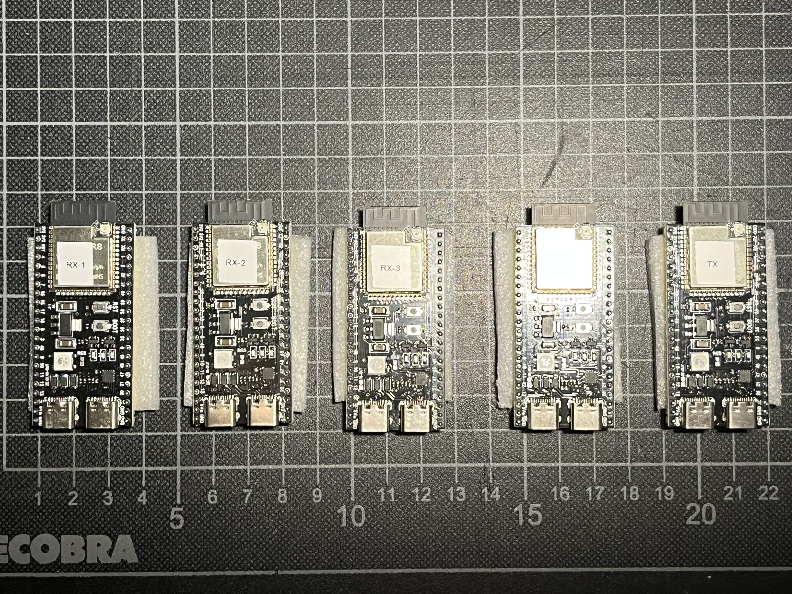
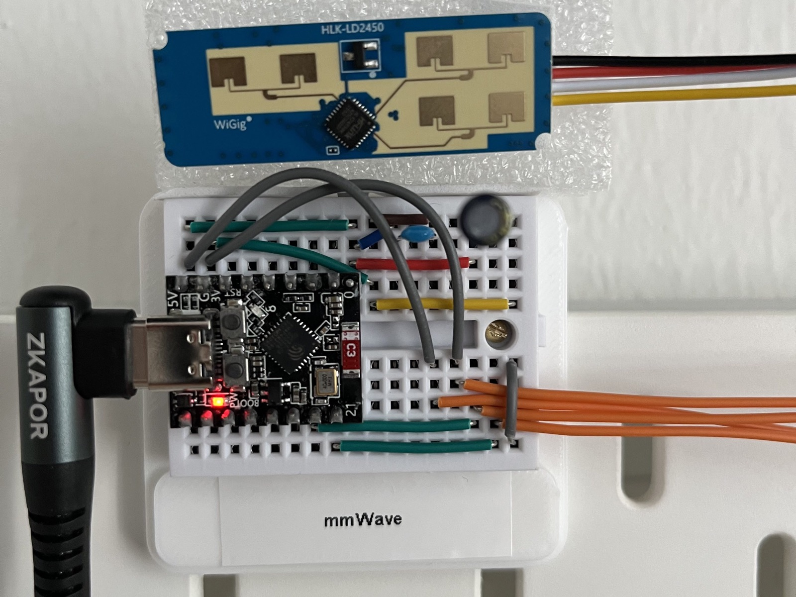
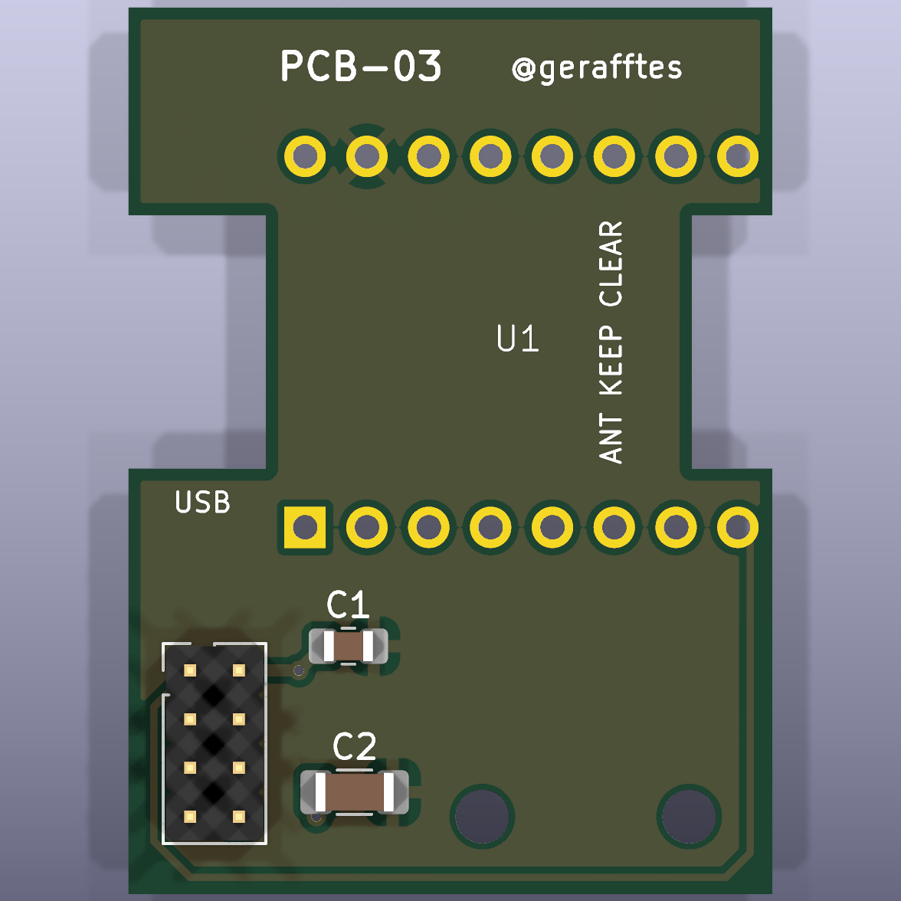
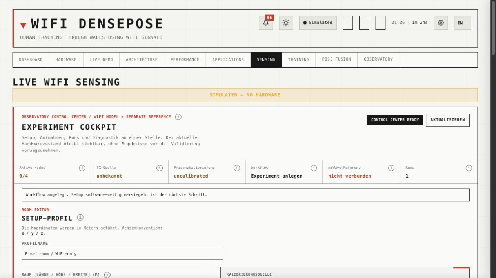
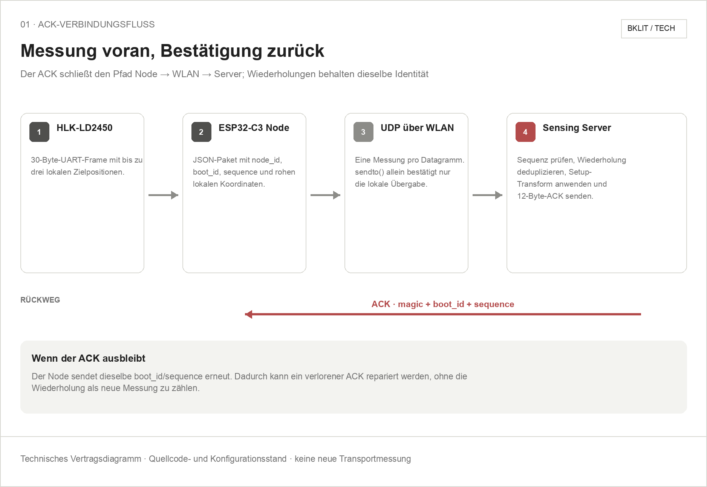
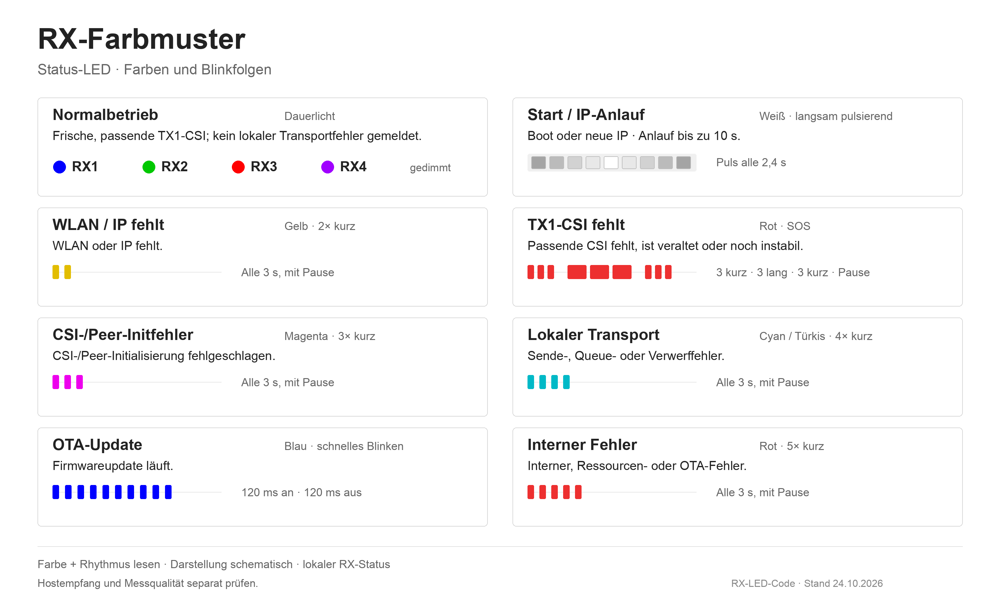

<a id="readme-top"></a>

<div align="center">
  <h1>Observatory</h1>
  <p>Explore what WiFi reveals about movement in a room — without cameras.<br>Record and examine wireless signals with ESP32 boards; the goal is continuous person localization.</p>
  <p><a href="software/README.md"><strong>Explore the documentation »</strong></a></p>
  <p>
    <a href="https://youtu.be/k27eQqz_vok">Project video</a> ·
    <a href="https://stardance.hackclub.com/projects/25673">Stardance</a> ·
    <a href="https://github.com/Gerafftes/Observatory/issues/new">Report a bug</a> ·
    <a href="https://github.com/Gerafftes/Observatory/issues">Request a feature</a> ·
    <a href="README.md">Deutsch</a>
  </p>
</div>

[![Stars][stars-shield]][stars-url]
[![Issues][issues-shield]][issues-url]
[![License][license-shield]][license-url]
[![Experimental][status-shield]](#current-validation-status)

<details>
  <summary>Table of contents</summary>
  <ol>
    <li><a href="#about-the-project">About the project</a></li>
    <li><a href="#getting-started">Getting started</a></li>
    <li><a href="#usage">Usage</a></li>
    <li><a href="#roadmap">Roadmap</a></li>
    <li><a href="#contributing">Contributing</a></li>
    <li><a href="#license">License</a></li>
    <li><a href="#contact">Contact</a></li>
    <li><a href="#acknowledgments">Acknowledgments</a></li>
  </ol>
</details>

## About the project

Observatory brings together Raw CSI capture, an experiment interface, and documented trials. It helps distinguish measured behavior from simulation and open research questions. Reliable continuous WiFi localization is still in development; there is no public live demo. The linked video is a recording.

<table>
  <tr>
    <td align="center" width="50%">
      <a href="project-media/esp32-s3-boards.jpeg"></a><br>
      <sub>ESP32-S3 boards: RX1 through RX4 and TX</sub>
    </td>
    <td align="center" width="50%">
      <a href="project-media/mmwave-breadboard-setup.jpeg"></a>
      <a href="hardware/pcb-03/"></a><br>
      <sub>mmWave: breadboard setup and PCB-03 board preview</sub>
    </td>
  </tr>
</table>

> **You are being sensed.**
>
> This room has a secret system, a machine that watches the Wi-Fi every second
> it is running. I know because I built it.
>
> I designed the machine to detect movement, but it sees every disturbance.
> Reflections caused by ordinary people—people like you. Signals the old
> algorithms considered “irrelevant.”
>
> They couldn’t understand them, so I decided I would. But I needed a partner,
> another sensor with the precision to reveal the truth.
>
> Bound by physics, we work without cameras. You’ll never see us. But moving or
> motionless, if you change the signal… we’ll find *you*.

*Inspired by the opening monologue of the TV series
[*Person of Interest*](https://en.wikipedia.org/wiki/Person_of_Interest_(TV_series)).*

<a id="what-observatory-can-do"></a>

### Features

- **Examine signals:** capture Raw CSI from four ESP32-S3 receivers; check
  sources, rates, time windows, and gaps.
- **Trace experiments:** bind setups and recordings to versions; keep
  training, blind prediction, and ground truth separate.
- **Compare radio links:** capture RX1↔RX4 alongside the four TX→RX links.
  The technical pair test passed; its positioning benefit remains open.

**The next goal:** a person moves freely through a calibrated room while the
system estimates their position from WiFi alone. Calibration is intended to use
slow walks, with two mmWave sensors supplying position labels and an independent
comparison reference.

The earlier D6 approach returns discrete points or zones, with `unknown` or
`ambiguous` for uncertain evidence. Continuous localization, multiple-person
tracking, and transfer to a second setup remain to be evaluated.

### Current validation status

**Documentation: November 1, 2026; measurements: October 29, 2026.** These statements summarize saved evidence.

| Area | Result | Limit |
|---|---|---|
| Four-RX capture | 180 s baseline passed: 173/173 shared valid windows | Does not establish positioning accuracy |
| RX1↔RX4 pair test | 300 s passed: 2,581/2,578 qualified peer frames; both directions 293/293 valid windows | Positioning benefit and a four-RX mesh remain open |
| 60 minutes TX-only | Passed after offline reassessment: 533,429 frames, 3,589/3,593 shared valid windows (99.89%; 90% required) | Original automatic closeout failed; no global firmware freeze follows from this result |
| Two mmWave references | Joint qualification pending | Spatial/time alignment and reference accuracy still need testing |
| Continuous WiFi localization | In development | Walking calibration and independent blind evaluation have not been demonstrated as a complete system |

The 60-minute run was reassessed twice with identical results; timing was
reconstructed from original evidence. The original online closeout failure
remains documented. The [Tag 14 result report](docs/project/rx-unified-tag14-result-20261029.md) documents the four-RX baseline and pair test; private raw data is not included.

Earlier D5-abs trials eliminated empty-room false presence but lost all still
recall, failing overall. Breathing/heart-rate indicators remain experimental
and are not physiologically validated.

> [!IMPORTANT]
> Passing capture and software checks proves neither lossless radio transmission nor reliable localization. Sequence gaps remain documented; radar positions and simulated displays are not WiFi localization evidence.

### Built with

[![Rust][rust-shield]][rust-url]
[![JavaScript][javascript-shield]][javascript-url]
[![Python][python-shield]][python-url]
[![ESP-IDF][esp-shield]][esp-url]
[![KiCad][kicad-shield]][kicad-url]

The host uses Rust with Tokio/Axum, the browser UI uses JavaScript, and the sensor nodes use ESP32/ESP-IDF. Python supplies measurement tooling; KiCad contains the editable electronics.

<p align="right">(<a href="#readme-top">back to top</a>)</p>

## Getting started

<a id="quick-start"></a>

### Prerequisites

For the simulation you need **Git**, a current **Rust/Cargo** toolchain (checked with Rust 1.96), and **Python 3** to generate a local demo signing key. No boards are needed.

Node.js is used for browser tests. Editing the [hardware](hardware/KICAD.md) needs KiCad 10 and its standard libraries; firmware builds additionally need the ESP-IDF setup in the relevant firmware guide.

### Installation

```bash
git clone https://github.com/Gerafftes/Observatory.git
cd Observatory/software/ruview/v2
WDP_RUFIELD_SIGNING_SEED="$(python3 -c 'import secrets; print(secrets.token_hex(32))')" \
cargo run --locked -p wifi-densepose-sensing-server --no-default-features -- \
  --source simulate --rx-session-only --bind-addr 127.0.0.1 --http-port 3002 --ws-port 3001
```

Then open `http://127.0.0.1:3002/ui/index.html#sensing`.
The command creates a temporary local demo signing key without saving it.
Real measurements require a separately configured persistent private key.

<p align="right">(<a href="#readme-top">back to top</a>)</p>

## Usage

1. **Explore:** follow the [cockpit guide](software/experiment-cockpit.en.md) through setup and measurement workflows.
2. **Assess:** read the [experiment results and limits](experiment-reports/README.en.md).
3. **Prepare:** check [hardware and revisions](hardware/README.en.md) before planning your own measurements.

> [!NOTE]
> Simulation shows the UI and workflow with artificial data (`SOFTWARE-ONLY / UNVALIDATED`). Real measurements require the local hardware setup and a separate calibration.

### User interface

The experiment cockpit lets you manage setup profiles, calibration, blind
captures, and evaluation. The [cockpit guide](software/experiment-cockpit.en.md)
walks through the workflow and mmWave calibration assistant.

<a href="software/experiment-cockpit.en.md"></a>

*Historical UI capture with simulated software state and no connected sensors. Details may differ from the current interface.*

### How it works

One ESP32-S3 transmits WiFi packets; four receivers measure Channel State
Information (CSI), the room's effect on the wireless channel. Movement,
obstruction, and reflections change these signals. The host collects and checks
the raw data.

The planned walking calibration starts with an empty-room capture, followed
by slow walks with mmWave as a reference. Separate training and test sessions
are intended to establish whether the WiFi model can localize new movements
without radar as an input. The [architecture page](experiment-reports/architecture/architecture.en.md)
explains the existing data paths and earlier D6 approach.

<p align="center">
  <a href="experiment-reports/architecture/architecture.en.md"></a>
</p>
<p align="center"><sub>This diagram shows one mmWave reference path. WiFi CSI and joint two-radar calibration are not shown here.</sub></p>

### Hardware

The WiFi setup requires five ESP32-S3 boards: TX1 and RX1 through RX4.
Two HLK-LD2450 sensors with ESP32-C3 boards are intended as calibration and
reference nodes. The images above show the earlier breadboard setup and PCB-03 preview.

- [Open all KiCad projects: PCB-01, PCB-02, PCB-03, and POC](hardware/KICAD.md)
- [PCB-03: current revision, KiCad sources, and manufacturing files](hardware/pcb-03/)
- [Breadboard: CAD, fastening hardware, and components](hardware/breadboard/README.en.md)
- [MMWAVE1/2: firmware and integration](software/ruview/firmware/esp32-mmwave-node/README.md)

PCB-01 and PCB-02 remain documented as earlier revisions in the
[hardware overview](hardware/README.en.md); use **PCB-03** for the current setup.

### RX status LED

Normal operation uses blue for RX1, green for RX2, red for RX3, and purple for
RX4. The overview also covers startup, connection, transport, and error states:

<a href="project-media/hardware/rx-status-led-patterns.png"></a>

### Project structure

The repository groups the editable project sources:

| Area | Contents |
|---|---|
| `software/ruview/` | Host, browser interface, firmware, tests, and required upstream sources |
| `hardware/` | KiCad projects with local footprints, CAD, and manufacturing files |
| `docs/` and `experiment-reports/` | Methods, result reports, and documented limits |
| `project-media/` and `measurement-templates/` | Public illustrations and templates |

The result reports contain aggregate findings. Raw recordings and device-specific
configuration are not distributed with the source. Build and test instructions
are in the [software guide](software/README.md).

### Documentation

| Your next step | Start here |
|---|---|
| Examine trials and results | [Historical experiment reports](experiment-reports/README.en.md) |
| Build the software and check provenance | [Software guide](software/README.md) · [RuView changes](docs/project/06-ruview-anpassungen.md) |
| Prepare your own measurements | [Measurement protocol](docs/project/03-messprotokoll.md) · [Measurement sheet](measurement-templates/messblatt.md) |
| Follow development and sources | [Project journal](docs/project/01-projektjournal.md) · [Research sources](docs/research/rf-sensing-sources.md) |

Technical development notes and individual experiment reports are mostly in German.

<p align="right">(<a href="#readme-top">back to top</a>)</p>

## Roadmap

- [x] Four-receiver capture and a reproducible experiment interface
- [x] Technical RX1↔RX4 pair test with qualified data in both directions
- [x] 60-minute TX-only capture, accepted after documented offline reassessment
- [x] Editable KiCad sources for PCB-01, PCB-02, PCB-03, and POC
- [ ] Joint spatial/time qualification of both mmWave reference nodes
- [ ] Walking calibration and independent blind evaluation of continuous WiFi localization
- [ ] Transfer to another room and evaluation of multiple-person tracking

<p align="right">(<a href="#readme-top">back to top</a>)</p>

## Contributing

Bug reports, reproducible counterexamples, documentation improvements, and pull requests are welcome. Describe the setup and separate simulated results from real measurements. Use synthetic test data and keep credentials or identifiable raw recordings out of issues and patches.

Discuss larger changes in an [issue][issues-url] first, then submit a focused pull request with the relevant checks. The [software guide](software/README.md) lists local test commands. Hardware results must be documented separately from software tests.

<p align="right">(<a href="#readme-top">back to top</a>)</p>

## License

<a id="license-and-credits"></a>

Observatory-owned material uses [PolyForm Noncommercial 1.0.0](LICENSE.md). Vendored components retain their own license and notice files; the root license does not replace those terms.

<p align="right">(<a href="#readme-top">back to top</a>)</p>

## Contact

[GitHub: @Gerafftes](https://github.com/Gerafftes)

Project: [Gerafftes/Observatory](https://github.com/Gerafftes/Observatory) · [Stardance](https://stardance.hackclub.com/projects/25673)

<p align="right">(<a href="#readme-top">back to top</a>)</p>

## Acknowledgments

- [ruvnet/RuView](https://github.com/ruvnet/RuView): upstream sensing software.
- [Espressif](https://www.espressif.com/en/products/socs/esp32): ESP32 platforms.
- [aiekick on MakerWorld](https://makerworld.com/de/models/1456361-esp32-s3-wroom-case#profileId-1517915): ESP32-S3-WROOM enclosure, under the MakerWorld Standard Digital File License.
- [*Person of Interest*](https://warnertv.de/serie/sendungen/person-of-interest): inspiration for the prologue.
- [Best-README-Template](https://github.com/othneildrew/Best-README-Template): README structure.

<p align="right">(<a href="#readme-top">back to top</a>)</p>

[stars-shield]: https://img.shields.io/github/stars/Gerafftes/Observatory.svg?style=for-the-badge
[stars-url]: https://github.com/Gerafftes/Observatory/stargazers
[issues-shield]: https://img.shields.io/github/issues/Gerafftes/Observatory.svg?style=for-the-badge
[issues-url]: https://github.com/Gerafftes/Observatory/issues
[license-shield]: https://img.shields.io/badge/License-PolyForm%20Noncommercial%201.0.0-blue?style=for-the-badge
[license-url]: LICENSE.md
[status-shield]: https://img.shields.io/badge/status-experimental-orange?style=for-the-badge
[rust-shield]: https://img.shields.io/badge/Rust-000000?style=for-the-badge&logo=rust&logoColor=white
[rust-url]: https://www.rust-lang.org/
[javascript-shield]: https://img.shields.io/badge/JavaScript-F7DF1E?style=for-the-badge&logo=javascript&logoColor=black
[javascript-url]: software/ruview/ui/
[python-shield]: https://img.shields.io/badge/Python-3776AB?style=for-the-badge&logo=python&logoColor=white
[python-url]: https://www.python.org/
[esp-shield]: https://img.shields.io/badge/ESP--IDF-E7352C?style=for-the-badge&logo=espressif&logoColor=white
[esp-url]: https://github.com/espressif/esp-idf
[kicad-shield]: https://img.shields.io/badge/KiCad-314CB0?style=for-the-badge&logo=kicad&logoColor=white
[kicad-url]: hardware/KICAD.md
