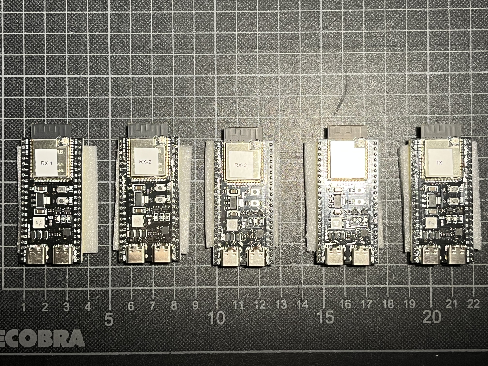
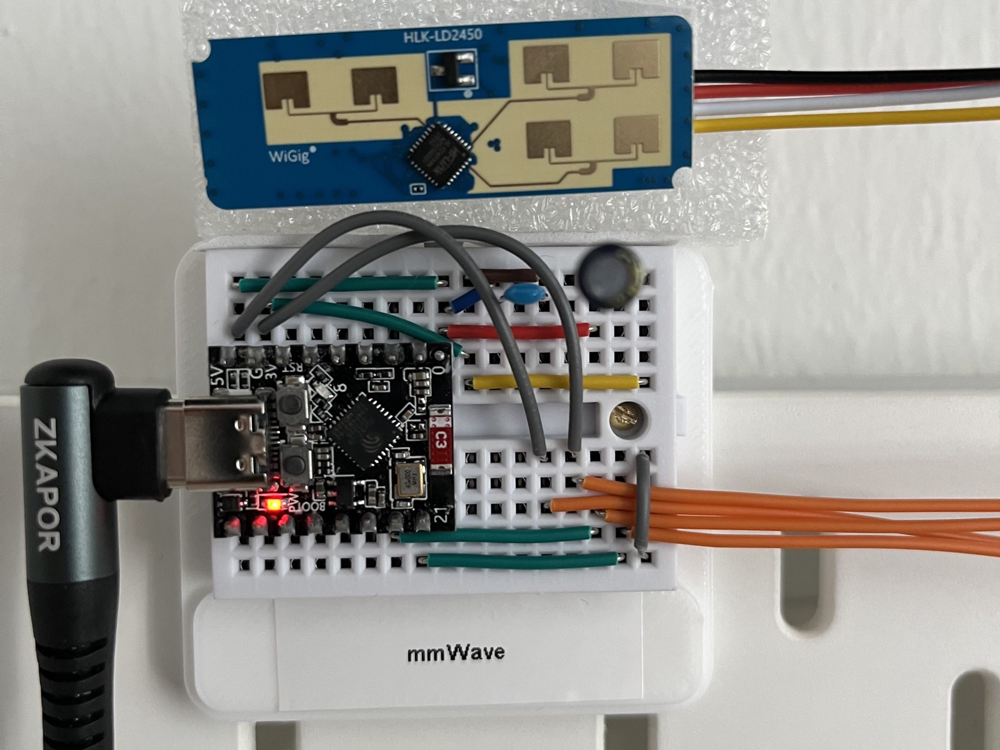
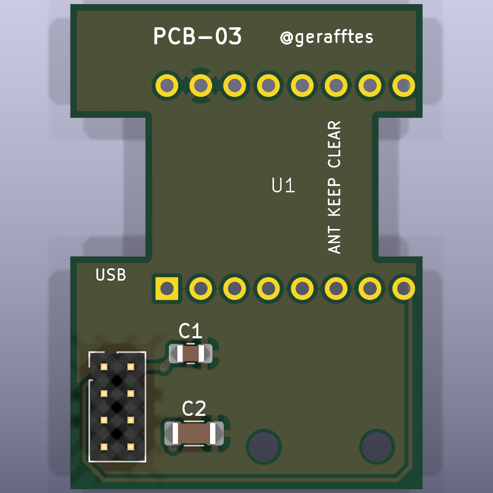
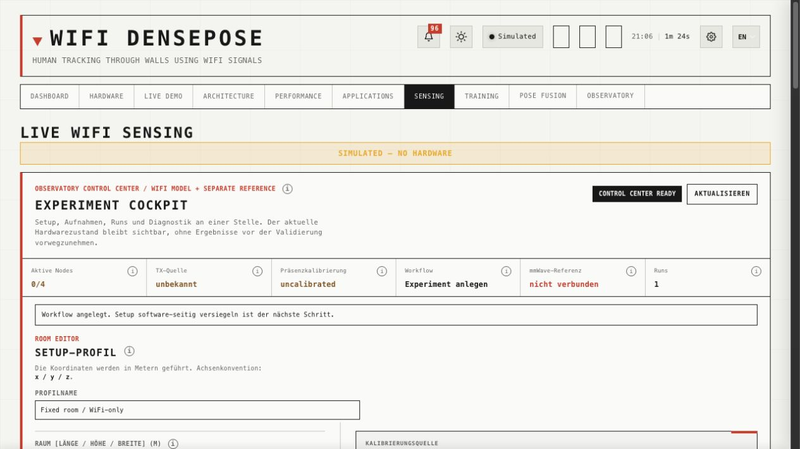
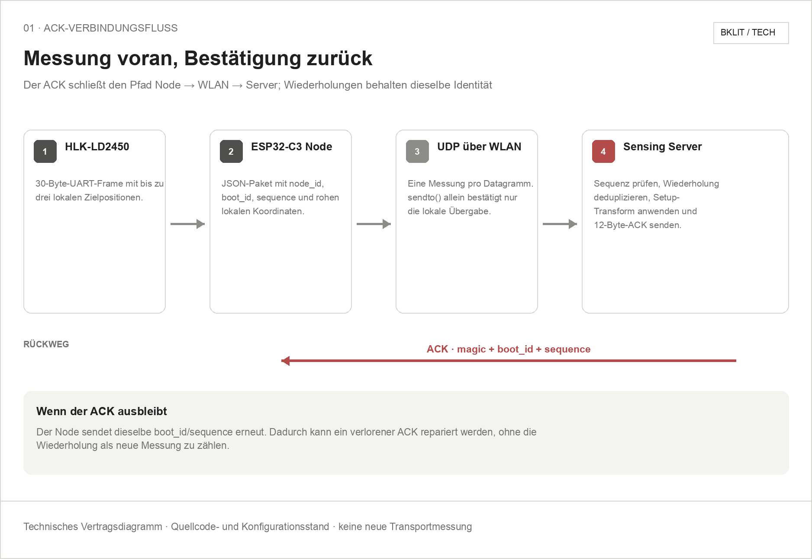

<h1 align="center">Observatory</h1>

<p align="center">
  Camera-free room sensing with WiFi: one transmitter and four ESP32-S3
  receivers capture changes in the wireless channel. The goal is continuous
  person localization, with two mmWave sensors for calibration and comparison.
</p>

<p align="center">
  <a href="https://stardance.hackclub.com/projects/25673">Stardance</a> ·
  <a href="#quick-start">Quick start</a> ·
  <a href="#what-observatory-can-do">Features</a> ·
  <a href="experiment-reports/README.en.md">Results</a> ·
  <a href="hardware/README.en.md">Hardware</a> ·
  <a href="docs/research/rf-sensing-sources.md">Sources</a> ·
  <a href="README.md">Deutsch</a>
</p>

<p align="center">
  <a href="https://stardance.hackclub.com/projects/25673"></a>
  <a href="#current-validation-status"></a>
  <a href="LICENSE.md"></a>
</p>

<table>
  <tr>
    <td align="center" width="50%">
      <a href="project-media/esp32-s3-boards.jpeg"></a><br>
      <sub>ESP32-S3 boards: RX1 through RX4 and TX</sub>
    </td>
    <td align="center" width="50%">
      <a href="project-media/mmwave-breadboard-setup.jpeg"></a>
      <a href="hardware/pcb-03/"></a><br>
      <sub>mmWave: breadboard setup and PCB-03 board preview</sub>
    </td>
  </tr>
</table>

## View the project

**[View Observatory on Stardance](https://stardance.hackclub.com/projects/25673)**

Observatory explores how people can be detected and localized through their
effect on WiFi signals. Four-receiver capture, an RX1↔RX4 pair comparison,
and a 60-minute TX-only stability result have been demonstrated. Reliable
continuous WiFi localization remains the next research goal.

There is currently no public live demo. Local development notes
describe the local measurement setup; the interface can be explored without
sensors in simulation mode. Current development reports are written in German.

> **You are being sensed.**
>
> This room has a secret system, a machine that watches the Wi-Fi every second
> it is running. I know because I built it.
>
> I built it to study movement: the reflections, the interruptions, the
> small changes ordinary people leave in a wireless signal. People like you.
>
> But a changing signal is not yet a position. To learn what it means,
> I needed a reference—another way to observe the room.
>
> Bound by physics, we work without cameras. Moving or motionless,
> you may change the signal. The question is what we can prove from it.

*Inspired by the opening monologue of the TV series
[*Person of Interest*](https://en.wikipedia.org/wiki/Person_of_Interest_(TV_series)).*

## Table of contents

- [View the project](#view-the-project)
- [Quick start](#quick-start)
- [What Observatory can do](#what-observatory-can-do)
- [Local checks](#local-checks)
- [Research question](#research-question)
- [Current validation status](#current-validation-status)
- [User interface](software/experiment-cockpit.en.md)
- [How it works](experiment-reports/architecture/architecture.en.md)
- [Verified results](experiment-reports/README.en.md)
- [Hardware](hardware/README.en.md)
- [Documentation](#documentation)
- [License](#license)
- [Credits](#credits)

## Quick start

This repository brings together project reports, hardware files, and the
Observatory source for the UI, backend, and firmware:

```bash
git clone https://github.com/Gerafftes/Observatory.git
cd Observatory
```

The documentation can be read directly. The UI and backend are stored together
under [`software/ruview/`](software/README.md). A hardware-free software run can
be started with:

```bash
cd software/ruview/v2
cargo run -p wifi-densepose-sensing-server --no-default-features -- \
  --source simulate --http-port 3002 --ws-port 3001
```

Then open `http://127.0.0.1:3002/ui/index.html#sensing`.

> [!NOTE]
> The `--source simulate` run checks the UI and workflow without hardware. It remains explicitly `SOFTWARE-ONLY / UNVALIDATED` and does not replace any hardware gate.

The main entry points are:

1. [Software, prerequisites, and provenance](software/README.md)
2. [Historical experiment results](experiment-reports/README.en.md)
3. [PCB-03 manufacturing files and KiCad sources](hardware/pcb-03/)
4. [MMWAVE1/2 firmware and device integration](software/ruview/firmware/esp32-mmwave-node/README.md)

Documented hardware runs are bound to their firmware, host, and setup versions.
A checkout does not automatically match the software installed on the devices
or qualified for a particular run.

The software is based on [ruvnet/RuView](https://github.com/ruvnet/RuView), but
the Observatory changes and required subprojects are included directly in this
repository. Provenance and pinned source revisions are listed in
[`software/README.md`](software/README.md); project-specific changes are
documented in [`06-ruview-anpassungen.md`](docs/project/06-ruview-anpassungen.md).

## What Observatory can do

- **Capture WiFi signals:** record Raw CSI from four ESP32-S3 receivers and
  bind measurements to the setup and software versions used.
- **Expose data quality:** check and account for sources, receiver identity,
  CSI layouts, rates, time windows, and gaps.
- **Make experiments traceable:** manage setup profiles, calibration, blind
  captures, and evaluation in the experiment cockpit; separate training,
  prediction, and ground truth through distinct files and cryptographic hashes.
- **Investigate additional radio links:** capture RX1↔RX4 CSI alongside the
  four TX→RX links. The technical pair comparison passed; its contribution
  to positioning accuracy still needs evaluation.

**In development:** continuous WiFi positions after calibration by slowly
walking through the room. Two independently qualified mmWave sensors are
intended to supply position labels and a separate comparison reference.
The eventual WiFi estimator is intended to use WiFi data alone.

The existing D6 pipeline estimates discrete points or zones, returning
`unknown` or `ambiguous` when evidence is insufficient or unclear. This earlier
approach does not yet fulfill the goal of continuous free-motion tracking.
Breathing and heart-rate indicators remain an experimental secondary topic
and are not physiologically validated.

## Local checks

The included software can be checked directly from the repository:

```bash
sh project_tools/verify_observatory_source.sh
node --test software/ruview/ui/tests/*.test.mjs
cargo check --manifest-path software/ruview/v2/Cargo.toml \
  -p wifi-densepose-sensing-server --no-default-features
python3 -m unittest project_tools/tests/test_evaluate_d5_replay.py
```

> [!WARNING]
> These checks process no new sensor signals. A passing software test, flash, or transport check does not prove live hardware or positioning accuracy.

## Research question

How reliably can presence, movement, and a person's continuous position be
estimated from WiFi CSI? What limits do room geometry, calibration, data quality,
and stability over time impose, and what additional value do radio links
between receivers provide?

The first goal is independently evaluated tracking of one person moving freely
in a calibrated room. Multiple-person tracking and transfer to a second setup
are subsequent development goals.

## Current validation status

**As of October 29, 2026** — a summary of saved measurement and evaluation
results, not ongoing device monitoring.

| Area | Status | Evidence and limits |
|---|---|---|
| Four-RX data foundation | Measurement sequence passed | Fresh boot qualification, 30 s pre-run, and 180 s baseline with 173/173 shared valid windows; device/host/PCAP accounting passed. |
| RX1↔RX4 | Technical pair comparison passed | 2,581 and 2,578 qualified peer frames in the 300 s run; both directions achieved 293/293 valid windows. Positioning benefit and a four-RX mesh are not established. |
| 60-minute TX-only run | Passed after offline reassessment | 3,600.024 s, 533,429 frames, and 3,589/3,593 shared valid windows (99.89%); original minimum requirement 90%. Resource and PCAP/Raw checks passed. |
| Automatic measurement closeout | Software correction pending | The original online worker failed during lengthy finalization. Reassessment confirms RX stability; it does not retroactively make that workflow successful or grant a global firmware freeze. |
| Two mmWave references | Joint qualification pending | Individual sensor checks, shared spatial/time alignment, and reference accuracy for walking calibration remain open. |
| Continuous WiFi localization | Development goal | Walking calibration, model comparison, and independent blind evaluation have not been demonstrated as a complete system. |
| Presence and vital indicators | Experimental | Earlier still-presence trials failed; breathing/heart-rate indicators are not physiologically validated. |
| Overall system | Not validated as a localization system | Capture and stability evidence do not replace real positioning or multiple-person acceptance tests. |

The data and pair test (Tag 14) was completed on October 29. The later 60-minute run
was reassessed twice with identical results using the 90% window requirement
specified before capture. Timing was reconstructed from saved original evidence;
the missing online end-clock check remains a failure of the original workflow.
Detailed stability-run evidence is stored privately outside this repository.

> [!IMPORTANT]
> Valid capture windows and complete PCAP/Raw matching do not prove lossless wireless transmission. Documented sequence gaps remain on record. Radar positions, simulated UI states, and smoothed zone sequences do not demonstrate continuous WiFi localization.

## User interface

The Observatory UI contains the mmWave calibration assistant and the
experiment cockpit for setup profiles, the WiFi workflow, blind captures, and
evaluation. Screenshots and the complete short guide are on the [separate
cockpit page](software/experiment-cockpit.en.md).

<a href="software/experiment-cockpit.en.md"></a>

> [!NOTE]
> The UI screenshots and demo flow show software states without connected sensors. They do not prove real CSI, radar, or positioning data.

## How it works

One ESP32-S3 transmits WiFi packets. Four distributed ESP32-S3 receivers
capture Channel State Information (CSI), which describes how the room changes
the wireless channel. People affect these signals through movement, obstruction,
and reflections. The host collects Raw CSI and checks which sections are suitable
for a shared comparison. The RX1↔RX4 pair path adds two directed radio links
to the four transmitter links.

The intended calibration workflow starts with an empty-room reference. A person
then walks slowly through the room while two mmWave sensors provide reference
positions aligned in space and time. Training and later validation use separate
recording sessions. The WiFi model is then intended to estimate positions without
radar as an input.

The [architecture page](experiment-reports/architecture/architecture.en.md)
documents the existing data paths and earlier discrete D6 approach. Local
development notes describe
the transition to walking calibration and continuous localization.

<p align="center">
  <a href="experiment-reports/architecture/architecture.en.md"></a>
</p>
<p align="center"><sub><strong>mmWave reference path:</strong> This diagram shows one HLK-LD2450 connected through an ESP32-C3. The WiFi CSI path and joint calibration with two radars are not shown here.</sub></p>

## Verified results

Development includes successful capture results and failed detection trials.
Each result applies to the documented setup and run:

- **October 29 — four RX and pair operation:** the complete measurement
  sequence through the 300 s pair capture and return to TX-only operation
  passed.
- **October 29 — 60 minutes TX-only:** the saved capture passes corrected
  offline evaluation with 99.89% shared valid windows. The original automatic
  closeout remains documented as failed.
- **September 20 — mmWave transport:** firmware 0.1.6 showed zero lost
  sequences in the examined [60 s comparison window](experiment-reports/2026-09-20_mmwave-sequenzverlustvergleich/README.md).
  This is not a general endurance or accuracy claim.
- **July/August — presence and D6:** D5-abs reduced empty-room false presence
  to 0% but also lost all still recall, failing overall. D6 demonstrated the
  technical capture and evaluation path, not positioning accuracy.

The [results overview](experiment-reports/README.en.md) collects historical
experiment packages with figures and tables. The newer RX results and remaining localization and radar tests are summarized
in the current validation status above. Their detailed development reports are
not yet part of the published documentation.

## Hardware

The WiFi setup consists of five ESP32-S3 boards: TX1 and RX1 through RX4.
Two HLK-LD2450 reference nodes with ESP32-C3 boards are intended for walking
calibration. The photo above documents the earlier provisional single-radar setup.
The [hardware documentation](hardware/README.en.md) collects PCBs, breadboard CAD,
components, and enclosure notes; the [mmWave firmware](software/ruview/firmware/esp32-mmwave-node/README.md)
describes MMWAVE1 and MMWAVE2 integration.

> [!IMPORTANT]
> **PCB-03 is the required revision for the current setup.** PCB-01 and PCB-02 remain documented as previous revisions.

- [PCB-01 Gerber and drill files](hardware/pcb-01/)
- [PCB-03 KiCad sources, validation reports, and ordering archive](hardware/pcb-03/)
- [Breadboard CAD, fastening hardware, and mmWave BOM](hardware/breadboard/README.en.md)

## Documentation

| File | Contents |
|---|---|
| [`00-status-und-annahmen.md`](docs/project/00-status-und-annahmen.md) | Setup, assumptions, coordinates, and open work |
| [`01-projektjournal.md`](docs/project/01-projektjournal.md) | Chronological development journal |
| [`02-versuchslog.md`](docs/project/02-versuchslog.md) | Experiments performed |
| [`03-messprotokoll.md`](docs/project/03-messprotokoll.md) | Measurement procedures and quality rules |
| [`04-auswertung-bis-problemfrage.md`](docs/project/04-auswertung-bis-problemfrage.md) | Analysis organized around the research question |
| [`05-erfolge-niederlagen-und-aenderungen.md`](docs/project/05-erfolge-niederlagen-und-aenderungen.md) | Successes, failures, and changes in direction |
| [`06-ruview-anpassungen.md`](docs/project/06-ruview-anpassungen.md) | Local changes to RuView |
| [`07-screenshot-nachweise.md`](docs/project/07-screenshot-nachweise.md) | Visual evidence and failure screenshots |
| [`08-aktueller-arbeitsstand-d6-und-position.md`](docs/project/08-aktueller-arbeitsstand-d6-und-position.md) | Historical D6 approach using discrete position fingerprints |
| [`architecture.en.md`](experiment-reports/architecture/architecture.en.md) | Architecture, data flow, and evidence separation |
| [`hardware/README.en.md`](hardware/README.en.md) | Hardware overview, PCBs, breadboard CAD, and fastening parts |
| [`software/experiment-cockpit.en.md`](software/experiment-cockpit.en.md) | UI screenshots and experiment workflow |
| [`software/`](software/README.md) | Complete UI, backend, and firmware source with provenance |
| [`experiment-reports/`](experiment-reports/) | Historical experiment packages with reports, figures, and tables |
| [`project-media/`](project-media/) | Curated project photos, UI images, and technical diagrams |
| [`project_tools/`](project_tools/) | Repository-wide validation, analysis, and rendering tools |
| [`historical-screenshots/`](historical-screenshots/) | Timestamped historical screenshots used as qualitative evidence |
| [`measurement-templates/messblatt.md`](measurement-templates/messblatt.md) | Measurement-sheet template |

## License

Observatory-owned material is licensed under the
[PolyForm Noncommercial License 1.0.0](LICENSE.md). The embedded RuView source
and its vendored components retain their respective license and notice files
under [`software/ruview/`](software/ruview/).

## Credits

- [ruvnet/RuView](https://github.com/ruvnet/RuView) is the documented software
  base for the embedded UI, firmware, and sensing-server source.
- [Espressif](https://www.espressif.com/en/products/socs/esp32) develops the
  ESP32 platforms used by this project.
- The ESP32-S3-WROOM enclosure was created by MakerWorld user
  [`aiekick`](https://makerworld.com/de/models/1456361-esp32-s3-wroom-case#profileId-1517915)
  and is offered under the MakerWorld Standard Digital File License.
- The cinematic prologue is inspired by the opening monologue of the TV series
  [*Person of Interest*](https://warnertv.de/serie/sendungen/person-of-interest).
