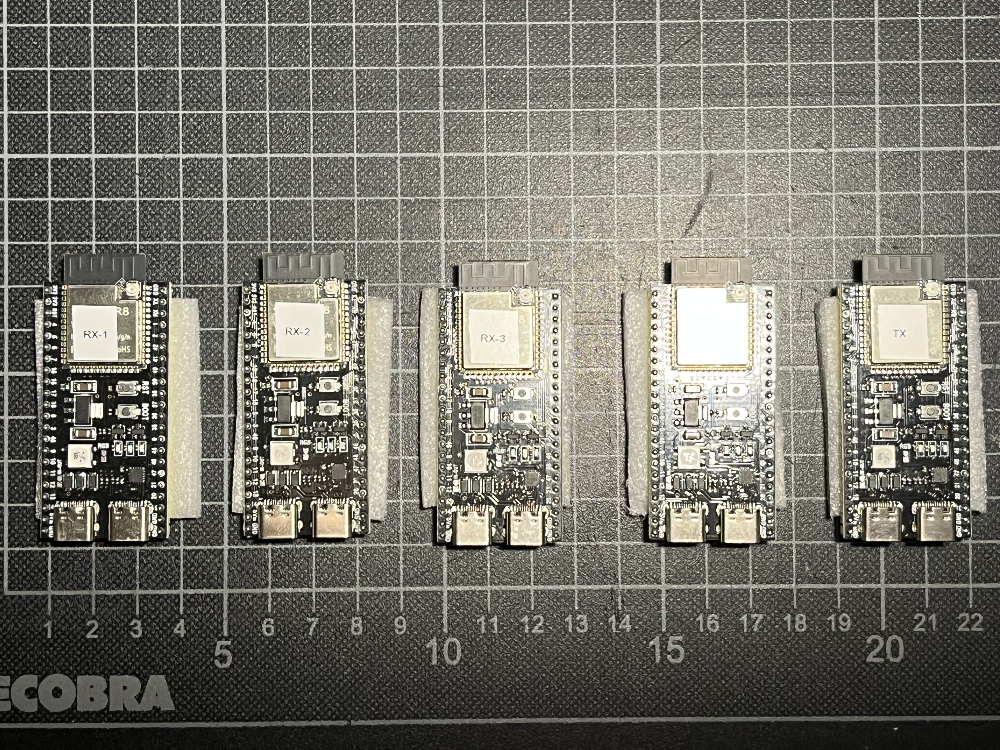
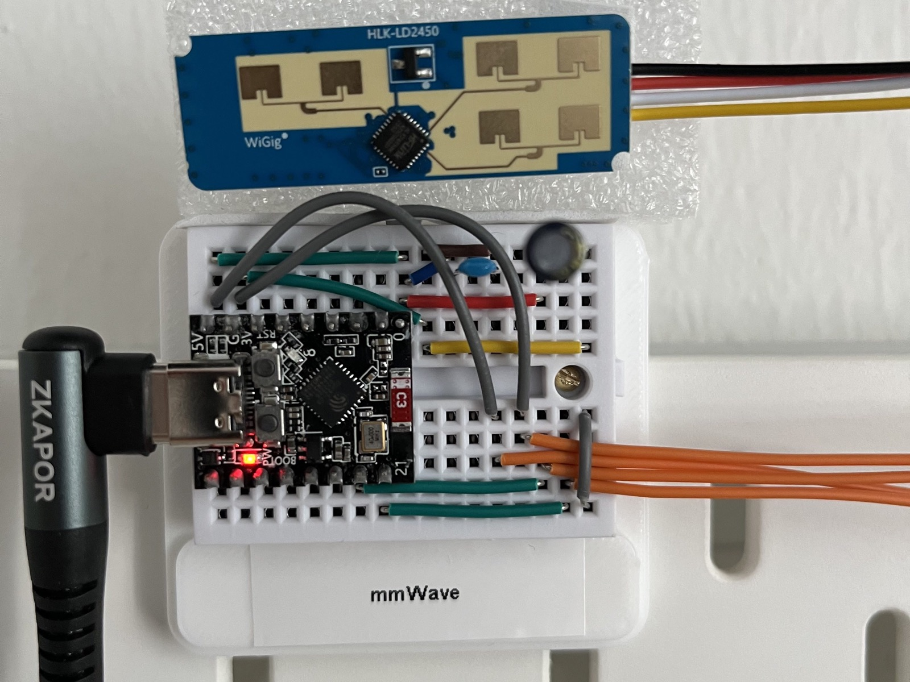
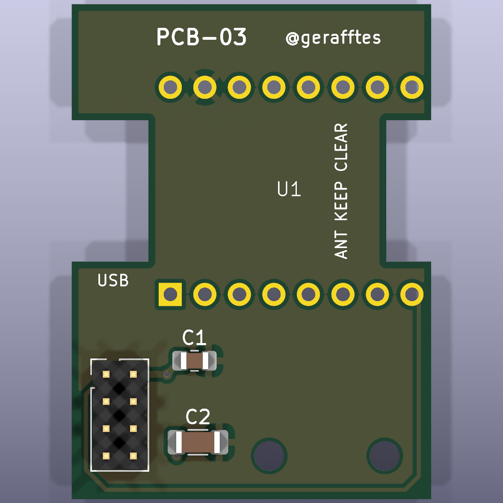
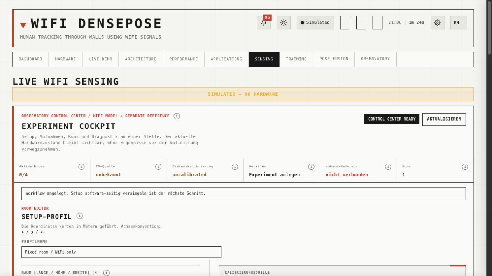
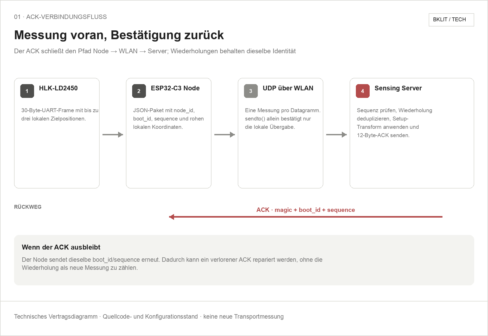
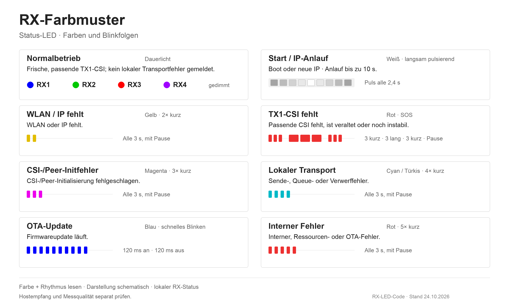

<a id="readme-top"></a>

<div align="center">
  <h1>Observatory</h1>
  <p>Erforsche, was WLAN über Bewegung im Raum verrät — ohne Kamera.<br>Zeichne Funksignale mit ESP32-Boards auf und untersuche sie; Ziel ist die fortlaufende Ortung einer Person.</p>
  <p><a href="software/README.md"><strong>Dokumentation erkunden »</strong></a></p>
  <p>
    <a href="https://youtu.be/k27eQqz_vok">Projektvideo</a> ·
    <a href="https://stardance.hackclub.com/projects/25673">Stardance</a> ·
    <a href="https://github.com/Gerafftes/Observatory/issues/new">Fehler melden</a> ·
    <a href="https://github.com/Gerafftes/Observatory/issues">Idee vorschlagen</a> ·
    <a href="README.en.md">English</a>
  </p>
</div>

[![Stars][stars-shield]][stars-url]
[![Issues][issues-shield]][issues-url]
[![License][license-shield]][license-url]
[![Experimental][status-shield]](#aktueller-validierungsstand)

<details>
  <summary>Inhaltsverzeichnis</summary>
  <ol>
    <li><a href="#über-das-projekt">Über das Projekt</a></li>
    <li><a href="#erste-schritte">Erste Schritte</a></li>
    <li><a href="#verwendung">Verwendung</a></li>
    <li><a href="#roadmap">Roadmap</a></li>
    <li><a href="#mitwirken">Mitwirken</a></li>
    <li><a href="#lizenz">Lizenz</a></li>
    <li><a href="#kontakt">Kontakt</a></li>
    <li><a href="#danksagungen">Danksagungen</a></li>
  </ol>
</details>

## Über das Projekt

Observatory verbindet Raw-CSI-Erfassung, eine Experiment-Oberfläche und dokumentierte Versuche. Damit lässt sich nachvollziehen, was tatsächlich gemessen wurde und welche Forschungsfragen offenbleiben. Zuverlässige fortlaufende WiFi-Ortung ist noch in Entwicklung; eine öffentliche Live-Demo gibt es nicht. Das verlinkte Video ist eine Aufzeichnung.

<table>
  <tr>
    <td align="center" width="50%">
      <a href="project-media/esp32-s3-boards.jpeg"></a><br>
      <sub>ESP32-S3-Boards: RX1 bis RX4 und TX</sub>
    </td>
    <td align="center" width="50%">
      <a href="project-media/mmwave-breadboard-setup.jpeg"></a>
      <a href="hardware/pcb-03/"></a><br>
      <sub>mmWave: Breadboard-Aufbau und PCB-03-Platinenvorschau</sub>
    </td>
  </tr>
</table>

> **You are being sensed.**
>
> This room has a secret system, a machine that watches the Wi-Fi every second
> it is running. I know because I built it.
>
> I designed the machine to detect movement, but it sees every disturbance.
> Reflections caused by ordinary people—people like you. Signals the old
> algorithms considered “irrelevant.”
>
> They couldn’t understand them, so I decided I would. But I needed a partner,
> another sensor with the precision to reveal the truth.
>
> Bound by physics, we work without cameras. You’ll never see us. But moving or
> motionless, if you change the signal… we’ll find *you*.

*Nach dem Intro der Serie
[*Person of Interest*](https://en.wikipedia.org/wiki/Person_of_Interest_(TV_series)).*

<a id="was-observatory-kann"></a>

### Funktionen

- **Signale untersuchen:** Raw-CSI von vier ESP32-S3-Empfängern erfassen;
  Quelle, Datenrate, Zeitfenster und Lücken prüfen.
- **Versuche nachvollziehen:** Aufbau und Aufnahmen an Versionen binden;
  Training, Blindvorhersage und Vergleichswahrheit getrennt halten.
- **Funkstrecken vergleichen:** RX1↔RX4 zusätzlich zu den vier TX→RX-Strecken
  erfassen. Der technische Paartest ist bestanden; sein Positionsnutzen ist offen.

**Das nächste Ziel:** Eine Person soll sich frei durch den kalibrierten Raum
bewegen können, während das System ihre Position allein aus WiFi-Daten schätzt.
Die Kalibrierung soll durch langsames Ablaufen erfolgen; zwei mmWave-Sensoren
sollen Positionslabels und eine unabhängige Vergleichsreferenz liefern.

Der bisherige D6-Ansatz liefert diskrete Punkte oder Zonen mit `unknown` oder
`ambiguous` bei unsicherer Evidenz. Freie Ortung, Mehrpersonenbetrieb und die
Übertragung auf einen zweiten Aufbau bleiben zu prüfen.

### Aktueller Validierungsstand

**Dokumentation: 1. November 2026; Messstand: 29. Oktober 2026.** Die Angaben fassen gespeicherte Befunde zusammen.

| Bereich | Ergebnis | Grenze |
|---|---|---|
| Vier-RX-Erfassung | 180-s-Basis bestanden: 173/173 gemeinsame gültige Fenster | Kein Nachweis der Positionsgenauigkeit |
| RX1↔RX4-Paartest | 300 s bestanden: 2.581/2.578 qualifizierte Peerframes, beide Richtungen 293/293 gültige Fenster | Positionsnutzen und Vier-RX-Mesh offen |
| 60 Minuten TX-only | Nach Offline-Neubewertung bestanden: 533.429 Frames, 3.589/3.593 gültige gemeinsame Fenster (99,89 %; mindestens 90 % gefordert) | Ursprünglicher automatischer Abschluss fehlgeschlagen; kein globaler Firmware-Freeze daraus |
| Zwei mmWave-Referenzen | Gemeinsame Abnahme offen | Raum-/Zeitzuordnung und Referenzgenauigkeit noch zu prüfen |
| Kontinuierliche WiFi-Ortung | In Entwicklung | Laufkalibrierung und unabhängige Blindprüfung noch nicht als Gesamtfunktion nachgewiesen |

Der 60-Minuten-Lauf wurde zweimal identisch neu ausgewertet; sein Zeitnachweis
wurde aus Originalbelegen rekonstruiert. Der Fehler des damaligen Online-Abschlusses
bleibt dokumentiert. Der [Tag-14-Ergebnisbericht](docs/project/rx-unified-tag14-result-20261029.md) dokumentiert die Vier-RX-Basis und den Paartest; private Rohdaten sind nicht enthalten.

Frühere D5-abs-Versuche beseitigten Leerraum-Fehlpräsenz, verloren aber den
Still-Recall vollständig und scheiterten insgesamt. Atem-/Herzfrequenzindikatoren
bleiben experimentell und sind nicht physiologisch validiert.

> [!IMPORTANT]
> Bestandene Erfassungs- und Softwareprüfungen belegen weder verlustfreie Funkübertragung noch zuverlässige Ortung. Sequenzlücken bleiben dokumentiert; Radarpositionen und simulierte Anzeigen sind keine WiFi-Ortungsnachweise.

### Technologien

[![Rust][rust-shield]][rust-url]
[![JavaScript][javascript-shield]][javascript-url]
[![Python][python-shield]][python-url]
[![ESP-IDF][esp-shield]][esp-url]
[![KiCad][kicad-shield]][kicad-url]

Der Host nutzt Rust mit Tokio/Axum, die Browseroberfläche JavaScript und die Sensorknoten ESP32/ESP-IDF. Python stellt Messwerkzeuge bereit; die bearbeitbare Elektronik liegt in KiCad vor.

<p align="right">(<a href="#readme-top">nach oben</a>)</p>

## Erste Schritte

<a id="schnelleinstieg"></a>

### Voraussetzungen

Für die Simulation brauchst du **Git**, eine aktuelle **Rust-/Cargo-Umgebung** (geprüft mit Rust 1.96) und **Python 3** zum Erzeugen eines lokalen Demo-Signaturschlüssels. Sensorboards sind dafür nicht erforderlich.

Für die Browser-Tests wird Node.js benötigt. Die [Hardwarebearbeitung](hardware/KICAD.md) setzt KiCad 10 und seine Standardbibliotheken voraus; Firmwarebuilds benötigen zusätzlich die ESP-IDF-Umgebung der jeweiligen Firmware-Anleitung.

### Installation

```bash
git clone https://github.com/Gerafftes/Observatory.git
cd Observatory/software/ruview/v2
WDP_RUFIELD_SIGNING_SEED="$(python3 -c 'import secrets; print(secrets.token_hex(32))')" \
cargo run --locked -p wifi-densepose-sensing-server --no-default-features -- \
  --source simulate --rx-session-only --bind-addr 127.0.0.1 --http-port 3002 --ws-port 3001
```

Öffne anschließend `http://127.0.0.1:3002/ui/index.html#sensing`.
Der Befehl erzeugt einen flüchtigen lokalen Demo-Signaturschlüssel; er wird nicht
gespeichert. Für echte Messungen muss ein eigener dauerhafter Schlüssel privat
konfiguriert werden.

<p align="right">(<a href="#readme-top">nach oben</a>)</p>

## Verwendung

1. **Erkunden:** Setup und Messablauf in der [Cockpit-Anleitung](software/experiment-cockpit.md) kennenlernen.
2. **Einordnen:** [Versuchsergebnisse und Grenzen](experiment-reports/README.md) lesen.
3. **Vorbereiten:** Für eigene Messungen [Hardware und Revisionen](hardware/README.md) prüfen.

> [!NOTE]
> Die Simulation zeigt UI und Workflow mit künstlichen Daten (`SOFTWARE-ONLY / UNVALIDATED`). Reale Messungen benötigen den lokalen Hardwareaufbau und eine eigene Kalibrierung.

### Benutzeroberfläche

Im Experiment-Cockpit kannst du Setup-Profile, Kalibrierung, Blindaufnahmen und
Auswertung verwalten. Die [Cockpit-Anleitung](software/experiment-cockpit.md)
führt durch den Ablauf und den mmWave-Kalibrierungsassistenten.

<a href="software/experiment-cockpit.md"></a>

*Historische UI-Aufnahme mit simuliertem Softwarezustand ohne angeschlossene Sensoren. Die aktuelle Oberfläche kann im Detail abweichen.*

### Wie es funktioniert

Ein ESP32-S3 sendet WLAN-Pakete; vier Empfänger messen Channel State Information
(CSI), also den Einfluss des Raums auf den Funkkanal. Bewegung, Abschattung und
Reflexionen verändern diese Signale. Der Host sammelt und prüft die Rohdaten.

Für die geplante Laufkalibrierung folgen auf eine Leerraumaufnahme langsame Wege
durch den Raum mit mmWave als Referenz. Getrennte Trainings- und Prüfsitzungen
sollen zeigen, ob das WiFi-Modell neue Bewegungen ohne Radar als Eingang orten kann.
Die [Architekturseite](experiment-reports/architecture/architecture.md) erklärt
die vorhandenen Datenpfade und den bisherigen D6-Ansatz.

<p align="center">
  <a href="experiment-reports/architecture/architecture.md"></a>
</p>
<p align="center"><sub>Das Diagramm zeigt einen mmWave-Referenzpfad. WiFi-CSI und die gemeinsame Zwei-Radar-Kalibrierung sind hier nicht dargestellt.</sub></p>

### Hardware

Für den WiFi-Aufbau brauchst du fünf ESP32-S3-Boards: TX1 und RX1 bis RX4.
Zwei HLK-LD2450 mit ESP32-C3 sind als Kalibrierungs- und Referenzknoten vorgesehen.
Oben siehst du den früheren Breadboard-Aufbau und die PCB-03-Vorschau.

- [Alle KiCad-Projekte öffnen: PCB-01, PCB-02, PCB-03 und POC](hardware/KICAD.md)
- [PCB-03: aktuelle Revision, KiCad-Quellen und Fertigungsdaten](hardware/pcb-03/)
- [Breadboard: CAD, Befestigungsteile und Bauteile](hardware/breadboard/README.md)
- [MMWAVE1/2: Firmware und Anbindung](software/ruview/firmware/esp32-mmwave-node/README.md)

PCB-01 und PCB-02 bleiben in der [Hardwareübersicht](hardware/README.md) als
frühere Revisionen dokumentiert; für den aktuellen Aufbau ist **PCB-03** zu verwenden.

### RX-Status-LED

Im Normalbetrieb: RX1 blau, RX2 grün, RX3 rot, RX4 violett.
Weitere Zustände erkennst du an Farbe und Blinkfolge:

<a href="project-media/hardware/rx-status-led-patterns.png"></a>

### Projektstruktur

Das Repository bündelt den bearbeitbaren Projektstand:

| Bereich | Inhalt |
|---|---|
| `software/ruview/` | Host, Browseroberfläche, Firmware, Tests und benötigte Fremdquellen |
| `hardware/` | KiCad-Projekte einschließlich lokaler Footprints, CAD und Fertigungsdaten |
| `docs/` und `experiment-reports/` | Methodik, Ergebnisberichte und dokumentierte Grenzen |
| `project-media/` und `measurement-templates/` | Öffentliche Abbildungen und Vorlagen |

Die Ergebnisberichte enthalten zusammengefasste Befunde. Rohaufzeichnungen und
gerätespezifische Konfiguration sind nicht Teil der Quellverteilung. Bau- und
Prüfbefehle stehen im [Software-Einstieg](software/README.md).

### Dokumentation

| Dein nächster Schritt | Einstieg |
|---|---|
| Versuche und Ergebnisse prüfen | [Historische Ergebnisberichte](experiment-reports/README.md) |
| Software bauen und Herkunft prüfen | [Software-Einstieg](software/README.md) · [RuView-Anpassungen](docs/project/06-ruview-anpassungen.md) |
| Eigene Messungen vorbereiten | [Messprotokoll](docs/project/03-messprotokoll.md) · [Messblatt](measurement-templates/messblatt.md) |
| Entwicklung und Quellen nachvollziehen | [Projektjournal](docs/project/01-projektjournal.md) · [Forschungsquellen](docs/research/rf-sensing-sources.md) |

<p align="right">(<a href="#readme-top">nach oben</a>)</p>

## Roadmap

- [x] Vier-RX-Erfassung und nachvollziehbare Experiment-Oberfläche
- [x] Technischer RX1↔RX4-Paartest mit qualifizierten Daten in beiden Richtungen
- [x] 60 Minuten TX-only-Erfassung, nach dokumentierter Offline-Neubewertung akzeptiert
- [x] Bearbeitbare KiCad-Quellen für PCB-01, PCB-02, PCB-03 und POC
- [ ] Gemeinsame Raum-/Zeitqualifikation beider mmWave-Referenzknoten
- [ ] Laufkalibrierung und unabhängige Blindprüfung fortlaufender WiFi-Ortung
- [ ] Übertragung auf einen weiteren Raum und Prüfung des Mehrpersonenbetriebs

<p align="right">(<a href="#readme-top">nach oben</a>)</p>

## Mitwirken

Fehlerberichte, reproduzierbare Gegenbeispiele, Dokumentationsverbesserungen und Pull Requests sind willkommen. Beschreibe den Aufbau und trenne Simulation von realen Messungen. Nutze synthetische Testdaten; Zugangsdaten oder identifizierbare Rohaufnahmen gehören nicht in Issues oder Patches.

Besprich größere Änderungen zunächst in einem [Issue][issues-url] und reiche danach einen begrenzten Pull Request mit passenden Prüfungen ein. Lokale Testbefehle stehen im [Software-Einstieg](software/README.md). Hardwarebefunde werden getrennt von Softwaretests dokumentiert.

<p align="right">(<a href="#readme-top">nach oben</a>)</p>

## Lizenz

<a id="lizenz-und-credits"></a>

Observatory-eigene Inhalte stehen unter [PolyForm Noncommercial 1.0.0](LICENSE.md). Für Drittkomponenten gelten weiterhin deren jeweilige Lizenz- und Notice-Dateien; die Root-Lizenz ersetzt diese Bedingungen nicht.

<p align="right">(<a href="#readme-top">nach oben</a>)</p>

## Kontakt

[GitHub: @Gerafftes](https://github.com/Gerafftes)

Projekt: [Gerafftes/Observatory](https://github.com/Gerafftes/Observatory) · [Stardance](https://stardance.hackclub.com/projects/25673)

<p align="right">(<a href="#readme-top">nach oben</a>)</p>

## Danksagungen

- [ruvnet/RuView](https://github.com/ruvnet/RuView): Basis der Sensing-Software.
- [Espressif](https://www.espressif.com/en/products/socs/esp32): ESP32-Plattformen.
- [aiekick auf MakerWorld](https://makerworld.com/de/models/1456361-esp32-s3-wroom-case#profileId-1517915): ESP32-S3-WROOM-Gehäuse unter MakerWorld Standard Digital File License.
- [*Person of Interest*](https://warnertv.de/serie/sendungen/person-of-interest): Inspiration für den Prolog.
- [Best-README-Template](https://github.com/othneildrew/Best-README-Template): Vorlage für die README-Struktur.

<p align="right">(<a href="#readme-top">nach oben</a>)</p>

[stars-shield]: https://img.shields.io/github/stars/Gerafftes/Observatory.svg?style=for-the-badge
[stars-url]: https://github.com/Gerafftes/Observatory/stargazers
[issues-shield]: https://img.shields.io/github/issues/Gerafftes/Observatory.svg?style=for-the-badge
[issues-url]: https://github.com/Gerafftes/Observatory/issues
[license-shield]: https://img.shields.io/badge/License-PolyForm%20Noncommercial%201.0.0-blue?style=for-the-badge
[license-url]: LICENSE.md
[status-shield]: https://img.shields.io/badge/status-experimental-orange?style=for-the-badge
[rust-shield]: https://img.shields.io/badge/Rust-000000?style=for-the-badge&logo=rust&logoColor=white
[rust-url]: https://www.rust-lang.org/
[javascript-shield]: https://img.shields.io/badge/JavaScript-F7DF1E?style=for-the-badge&logo=javascript&logoColor=black
[javascript-url]: software/ruview/ui/
[python-shield]: https://img.shields.io/badge/Python-3776AB?style=for-the-badge&logo=python&logoColor=white
[python-url]: https://www.python.org/
[esp-shield]: https://img.shields.io/badge/ESP--IDF-E7352C?style=for-the-badge&logo=espressif&logoColor=white
[esp-url]: https://github.com/espressif/esp-idf
[kicad-shield]: https://img.shields.io/badge/KiCad-314CB0?style=for-the-badge&logo=kicad&logoColor=white
[kicad-url]: hardware/KICAD.md
