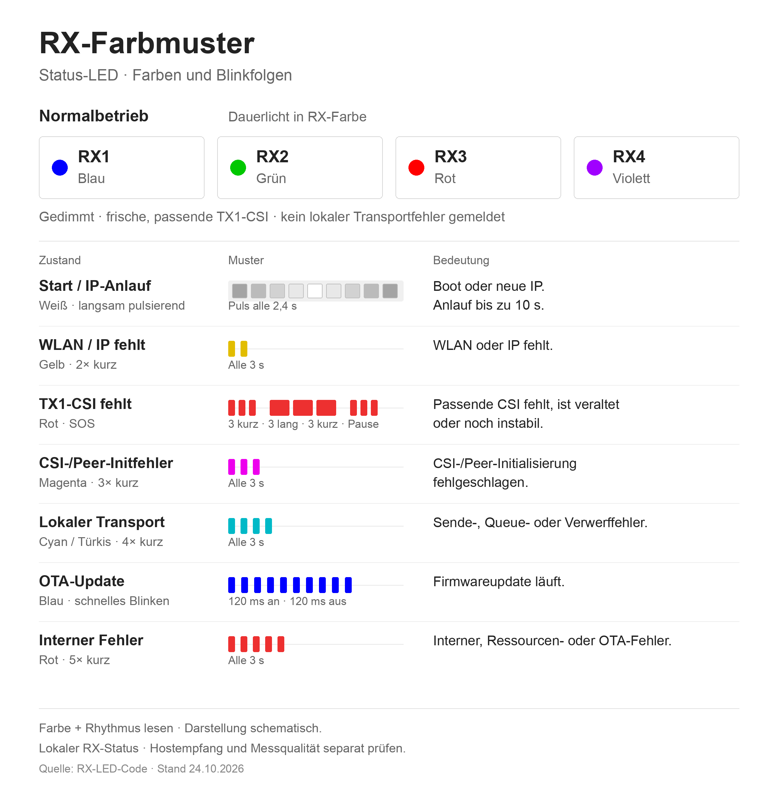

<h1 align="center">Observatory</h1>

<p align="center">
  Kamerafreie Raumwahrnehmung mit WLAN: Ein Sender und vier ESP32-S3-Empfänger
  erfassen Veränderungen im Funksignal. Ziel ist die fortlaufende Ortung einer
  Person; zwei mmWave-Sensoren dienen als Kalibrierungs- und Vergleichsreferenz.
</p>

<p align="center">
  <a href="https://stardance.hackclub.com/projects/25673">Stardance</a> ·
  <a href="#schnelleinstieg">Schnellstart</a> ·
  <a href="#was-observatory-kann">Features</a> ·
  <a href="experiment-reports/README.md">Ergebnisse</a> ·
  <a href="hardware/README.md">Hardware</a> ·
  <a href="docs/research/rf-sensing-sources.md">Quellen</a> ·
  <a href="README.en.md">English</a>
</p>

<p align="center">
  <a href="https://stardance.hackclub.com/projects/25673"></a>
  <a href="#aktueller-validierungsstand"></a>
  <a href="LICENSE.md"></a>
</p>

<table>
  <tr>
    <td align="center" width="50%">
      <a href="project-media/esp32-s3-boards.jpeg"></a><br>
      <sub>ESP32-S3-Boards: RX1 bis RX4 und TX</sub>
    </td>
    <td align="center" width="50%">
      <a href="project-media/mmwave-breadboard-setup.jpeg"></a><br>
      <sub>Vorläufiger mmWave-Breadboard-Aufbau</sub>
    </td>
  </tr>
</table>

## Projekt ansehen

**[Observatory auf Stardance ansehen](https://stardance.hackclub.com/projects/25673)**

Observatory untersucht, wie sich Menschen anhand ihrer Wirkung auf WLAN-Signale
im Raum erkennen und lokalisieren lassen. Die Erfassung mit vier Empfängern,
ein RX1↔RX4-Paarvergleich und ein 60-Minuten-TX-only-Stabilitätsnachweis sind
belegt. Zuverlässige fortlaufende WiFi-Ortung bleibt das nächste Forschungsziel.

Eine öffentliche Live-Demo gibt es derzeit nicht. Der lokale Messaufbau wird
in den lokalen Entwicklungsunterlagen
beschrieben; ohne Sensoren lässt sich die Oberfläche im Simulationsmodus ansehen.

> **You are being sensed.**
>
> This room has a secret system, a machine that watches the Wi-Fi every second
> it is running. I know because I built it.
>
> I built it to study movement: the reflections, the interruptions, the
> small changes ordinary people leave in a wireless signal. People like you.
>
> But a changing signal is not yet a position. To learn what it means,
> I needed a reference—another way to observe the room.
>
> Bound by physics, we work without cameras. Moving or motionless,
> you may change the signal. The question is what we can prove from it.

*Nach dem Intro der Serie
[*Person of Interest*](https://en.wikipedia.org/wiki/Person_of_Interest_(TV_series)).*

## Inhaltsverzeichnis

- [Projekt ansehen](#projekt-ansehen)
- [Schnelleinstieg](#schnelleinstieg)
- [Was Observatory kann](#was-observatory-kann)
- [Lokale Checks](#lokale-checks)
- [Forschungsfrage](#forschungsfrage)
- [Aktueller Validierungsstand](#aktueller-validierungsstand)
- [Benutzeroberfläche](software/experiment-cockpit.md)
- [Wie es funktioniert](experiment-reports/architecture/architecture.md)
- [Belastbare Ergebnisse](experiment-reports/README.md)
- [Hardware](hardware/README.md)
- [Dokumentation](#dokumentation)
- [Lizenz](#lizenz)
- [Credits](#credits)

## Schnelleinstieg

Dieses Repository bündelt Projektberichte, Hardwaredateien und den
Observatory-Quellstand mit UI, Backend und Firmware:

```bash
git clone https://github.com/Gerafftes/Observatory.git
cd Observatory
```

Die Dokumentation kann direkt gelesen werden. UI und Backend liegen gemeinsam
unter [`software/ruview/`](software/README.md). Ein Softwaretest ohne Hardware
lässt sich so starten:

```bash
cd software/ruview/v2
cargo run -p wifi-densepose-sensing-server --no-default-features -- \
  --source simulate --http-port 3002 --ws-port 3001
```

Danach ist die Sensing-UI unter
`http://127.0.0.1:3002/ui/index.html#sensing` erreichbar.

> [!NOTE]
> Der Lauf mit `--source simulate` prüft UI und Workflow ohne Hardware. Er bleibt ausdrücklich `SOFTWARE-ONLY / UNVALIDATED` und ersetzt kein Hardware-Gate.

Die wichtigsten Einstiegspunkte sind:

1. [Software, Voraussetzungen und Herkunft](software/README.md)
2. [Historische Versuchsergebnisse](experiment-reports/README.md)
3. [PCB-03-Fertigungsdaten und KiCad-Quellen](hardware/pcb-03/)
4. [MMWAVE1/2-Firmware und Geräteanbindung](software/ruview/firmware/esp32-mmwave-node/README.md)

Die dokumentierten Hardwareläufe sind an ihre jeweiligen Firmware-, Host- und
Setup-Versionen gebunden. Der Quellstand eines Checkouts ist nicht automatisch
der auf den Geräten installierte oder für einen bestimmten Lauf geprüfte Stand.

Die Software basiert auf [ruvnet/RuView](https://github.com/ruvnet/RuView), ist
aber mit den Observatory-Anpassungen und den benötigten Unterprojekten direkt
im Repository enthalten. Herkunft und festgeschriebene Quellstände stehen in
[`software/README.md`](software/README.md); die Projektanpassungen sind unter
[`06-ruview-anpassungen.md`](docs/project/06-ruview-anpassungen.md) dokumentiert.

## Was Observatory kann

- **WLAN-Signale erfassen:** Raw-CSI von vier ESP32-S3-Empfängern aufzeichnen
  und Messungen an die verwendete Aufbau- und Softwareversion binden.
- **Datenqualität sichtbar machen:** Quellen, Empfängeridentität, CSI-Layouts,
  Raten, Zeitfenster und Datenlücken prüfen und bilanzieren.
- **Experimente nachvollziehbar auswerten:** Setup-Profile, Kalibrierung,
  Blindaufnahmen und Evaluation im Experiment-Cockpit verwalten; Training,
  Vorhersage und Wahrheit durch getrennte Dateien und Hashbindungen trennen.
- **Zusätzliche Funkstrecken untersuchen:** RX1↔RX4-CSI neben den vier
  TX→RX-Strecken erfassen. Der technische Paarvergleich ist bestanden;
  sein Nutzen für die Positionsgenauigkeit ist noch zu bewerten.

**In Entwicklung:** fortlaufende WiFi-Positionen nach einer Kalibrierung durch
langsames Ablaufen des Raums. Zwei unabhängig geprüfte mmWave-Sensoren sollen
dabei Positionslabels und eine getrennte Vergleichsreferenz liefern. Die
spätere WiFi-Schätzung soll ausschließlich WiFi-Daten verwenden.

Die vorhandene D6-Pipeline schätzt diskrete Punkte beziehungsweise Zonen mit
`unknown` und `ambiguous` bei unzureichender oder mehrdeutiger Evidenz. Sie ist
ein bisheriger Ansatz und erfüllt das Ziel freier Positionsverfolgung noch nicht.
Atem- und Herzfrequenzindikatoren bleiben ein experimenteller Nebenbereich
und sind nicht physiologisch validiert.

## Lokale Checks

Der enthaltene Softwarestand lässt sich aus dem Repository heraus prüfen:

```bash
sh project_tools/verify_observatory_source.sh
node --test software/ruview/ui/tests/*.test.mjs
cargo check --manifest-path software/ruview/v2/Cargo.toml \
  -p wifi-densepose-sensing-server --no-default-features
python3 -m unittest project_tools/tests/test_evaluate_d5_replay.py
```

> [!WARNING]
> Die Checks verarbeiten keine neuen Sensorsignale. Ein bestandener Softwaretest, Flashvorgang oder Transportnachweis beweist keine Live-Hardware- oder Positionsgenauigkeit.

## Forschungsfrage

Wie zuverlässig lassen sich Anwesenheit, Bewegung und die fortlaufende
Position einer Person aus WLAN-CSI bestimmen? Welche Grenzen setzen
Raumgeometrie, Kalibrierung, Datenqualität und zeitliche Stabilität, und welchen
zusätzlichen Nutzen bringen Funkstrecken zwischen den Empfängern?

Zuerst soll die freie Bewegung einer Person im kalibrierten Raum unabhängig
geprüft werden. Mehrpersonenbetrieb und die Übertragung auf einen zweiten
Aufbau sind nachfolgende Entwicklungsziele.

## Aktueller Validierungsstand

**Stand: 29. Oktober 2026** — Zusammenfassung gespeicherter Mess- und
Auswertungsbefunde, keine laufende Geräteüberwachung.

| Bereich | Status | Aussage und Grenze |
|---|---|---|
| Vier-RX-Datenbasis | Messfolge bestanden | Frische Bootqualifikation, 30-s-Vorlauf und 180-s-Basis mit 173/173 gemeinsamen gültigen Fenstern; Geräte-/Host-/PCAP-Abgleich bestanden. |
| RX1↔RX4 | Technischer Paarvergleich bestanden | Im 300-s-Lauf 2.581 beziehungsweise 2.578 qualifizierte Peerframes; beide Richtungen mit 293/293 gültigen Fenstern. Positionsnutzen und Vier-RX-Mesh sind damit nicht bewiesen. |
| 60-Minuten-TX-only-Lauf | Nach Offline-Neubewertung bestanden | 3.600,024 s, 533.429 Frames und 3.589/3.593 gemeinsame gültige Fenster (99,89 %); ursprüngliche Mindestanforderung 90 %. Ressourcen- und PCAP/Raw-Prüfungen bestanden. |
| Automatischer Messabschluss | Softwarekorrektur offen | Der ursprüngliche Onlineworker scheiterte an der langen Finalisierung. Die Datenneubewertung bestätigt die RX-Stabilität; sie macht den damaligen Ablauf nicht nachträglich fehlerfrei und erteilt keinen globalen Firmware-Freeze. |
| Zwei mmWave-Referenzen | Gemeinsame Abnahme offen | Einzelprüfung, gemeinsame Raum-/Zeitzuordnung und Referenzgenauigkeit für die Laufkalibrierung stehen noch aus. |
| Kontinuierliche WiFi-Ortung | Entwicklungsziel | Laufkalibrierung, Modellvergleich und unabhängige Blindprüfung sind noch nicht als Gesamtfunktion nachgewiesen. |
| Präsenz und Vitalindikatoren | Experimentell | Frühere Still-Präsenz-Versuche scheiterten; Atem-/Herzfrequenzindikatoren sind nicht physiologisch validiert. |
| Gesamtsystem | Nicht als Ortungssystem validiert | Erfassungs- und Stabilitätsnachweise ersetzen keine reale Positions- oder Mehrpersonenabnahme. |

Der Daten- und Paartest (Tag 14) wurde am 29. Oktober abgeschlossen. Der spätere
60-Minuten-Lauf wurde mit der bereits vorab verlangten 90-%-Fensterregel
zweimal identisch neu ausgewertet. Sein Zeitnachweis wurde aus gespeicherten
Originalbelegen rekonstruiert; die damals fehlende Online-Enduhrprüfung bleibt
als Fehler des ursprünglichen Ablaufs erhalten. Die ausführlichen
Dauerlaufbelege liegen privat außerhalb dieses Repositorys.

> [!IMPORTANT]
> Gültige Aufnahmefenster und vollständiger PCAP/Raw-Abgleich belegen keine verlustfreie Funkübertragung. Die dokumentierten Sequenzlücken bleiben erhalten. Radarpositionen, simulierte UI-Zustände und geglättete Zonenfolgen sind kein Nachweis kontinuierlicher WiFi-Ortung.

## Benutzeroberfläche

Das Observatory-UI enthält den mmWave-Kalibrierungsassistenten und das
Experiment-Cockpit für Setup-Profil, WiFi-Workflow, Blindaufnahmen und
Evaluation. Die Screenshots und die vollständige Kurzanleitung stehen auf der
[separaten Cockpit-Seite](software/experiment-cockpit.md).

<a href="software/experiment-cockpit.md"></a>

> [!NOTE]
> Die UI-Abbildungen und der Demo-Ablauf zeigen Softwarezustände ohne angeschlossene Sensoren. Sie sind kein Nachweis realer CSI-, Radar- oder Positionsdaten.

## Wie es funktioniert

Ein ESP32-S3 sendet WLAN-Pakete. Vier verteilte ESP32-S3-Empfänger erfassen
Channel State Information (CSI): Sie beschreibt, wie der Raum den Funkkanal
verändert. Menschen beeinflussen diese Signale durch Bewegung, Abschattung
und Reflexionen. Der Host sammelt die Rohdaten und prüft, welche Abschnitte
für einen gemeinsamen Vergleich geeignet sind. Der RX1↔RX4-Paarpfad ergänzt
die vier TX-Strecken um zwei weitere gerichtete Funkstrecken.

Der angestrebte Kalibrierablauf beginnt mit einer Leerraumreferenz. Danach
wird der Raum langsam abgelaufen; zwei mmWave-Sensoren sollen die zeitlich und
räumlich zugeordneten Referenzpositionen liefern. Training und spätere
Validierung verwenden getrennte Aufnahmesitzungen. Das WiFi-Modell soll
anschließend Positionen ohne Radar als Eingang schätzen.

Die [Architekturseite](experiment-reports/architecture/architecture.md)
dokumentiert die vorhandenen Datenpfade und den bisherigen diskreten
D6-Ansatz. Die lokalen Entwicklungsunterlagen
beschreiben den Übergang zur Laufkalibrierung und fortlaufenden Ortung.

<p align="center">
  <a href="experiment-reports/architecture/architecture.md"></a>
</p>
<p align="center"><sub><strong>mmWave-Referenzpfad:</strong> Das Diagramm zeigt die Anbindung eines HLK-LD2450 über einen ESP32-C3. Der WLAN-CSI-Pfad und die gemeinsame Kalibrierung mit zwei Radaren sind hier nicht dargestellt.</sub></p>

## Belastbare Ergebnisse

Die Entwicklung umfasst erfolgreiche Erfassungsnachweise und gescheiterte
Erkennungsversuche. Jeder Befund gilt für den dokumentierten Aufbau und Lauf:

- **29. Oktober — Vier RX und Paarbetrieb:** Die vollständige Messfolge bis
  zur 300-s-Paaraufnahme samt Rückkehr in den TX-only-Betrieb ist
  bestanden.
- **29. Oktober — 60 Minuten TX-only:** Die vorhandene Aufnahme besteht nach
  korrigierter Offline-Auswertung mit 99,89 % gültigen gemeinsamen Fenstern.
  Der ursprüngliche automatische Abschluss bleibt als fehlgeschlagen dokumentiert.
- **20. September — mmWave-Transport:** Firmware 0.1.6 zeigte im untersuchten
  [60-s-Vergleichsfenster](experiment-reports/2026-09-20_mmwave-sequenzverlustvergleich/README.md)
  null verlorene Sequenzen. Das ist keine allgemeine Dauerlauf- oder Genauigkeitszusage.
- **Juli/August — Präsenz und D6:** D5-abs senkte die Leerraum-Fehlpräsenz auf
  0 %, verlor aber zugleich den Still-Recall vollständig und bestand insgesamt
  nicht. D6 belegte den technischen Aufnahme- und Auswertungspfad, keine
  Positionsgenauigkeit.

Die [Ergebnisübersicht](experiment-reports/README.md) bündelt die historischen
Versuchspakete mit Diagrammen und Tabellen. Die neueren RX-Abschlüsse und die verbleibenden Ortungs- und Radarprüfungen
sind oben im aktuellen Validierungsstand zusammengefasst. Ihre ausführlichen
Entwicklungsberichte sind noch nicht Teil des veröffentlichten Dokumentationsstands.

## Hardware

Der WiFi-Aufbau besteht aus fünf ESP32-S3-Boards: TX1 und RX1 bis RX4. Für
die Laufkalibrierung sind zwei HLK-LD2450-Referenzknoten mit ESP32-C3 vorgesehen.
Das Foto oben dokumentiert den früheren provisorischen Einzelradar-Aufbau.
Die [Hardware-Dokumentation](hardware/README.md) bündelt Platinen, Breadboard-CAD,
Bauteile und Gehäusehinweise; die [mmWave-Firmware](software/ruview/firmware/esp32-mmwave-node/README.md)
beschreibt die Anbindung von MMWAVE1 und MMWAVE2.

> [!IMPORTANT]
> Für den aktuellen Aufbau ist ausdrücklich **PCB-03** zu verwenden. PCB-01 und PCB-02 bleiben als frühere Revisionen dokumentiert.

- [PCB-01 Gerber- und Bohrdaten](hardware/pcb-01/)
- [PCB-03 KiCad-Quellen, Prüfberichte und Bestellarchiv](hardware/pcb-03/)
- [Breadboard-CAD, Befestigungsteile und mmWave-BOM](hardware/breadboard/README.md)

### RX-Status-LED

Im Normalbetrieb leuchten RX1 blau, RX2 grün, RX3 rot und RX4 violett.
Die Übersicht erklärt die weiteren Zustände anhand von Farbe und Blinkfolge.

<a href="devlogs/RX_Farbmuster.png"></a>

## Dokumentation

| Datei | Inhalt |
|---|---|
| [`00-status-und-annahmen.md`](docs/project/00-status-und-annahmen.md) | Aufbau, Annahmen, Koordinaten und offene Punkte |
| [`01-projektjournal.md`](docs/project/01-projektjournal.md) | Chronologischer Entwicklungsverlauf |
| [`02-versuchslog.md`](docs/project/02-versuchslog.md) | Durchgeführte Versuche |
| [`03-messprotokoll.md`](docs/project/03-messprotokoll.md) | Messabläufe und Qualitätsregeln |
| [`04-auswertung-bis-problemfrage.md`](docs/project/04-auswertung-bis-problemfrage.md) | Auswertung entlang der Forschungsfrage |
| [`05-erfolge-niederlagen-und-aenderungen.md`](docs/project/05-erfolge-niederlagen-und-aenderungen.md) | Erfolge, Fehlschläge und Kursänderungen |
| [`06-ruview-anpassungen.md`](docs/project/06-ruview-anpassungen.md) | Lokale Änderungen an RuView |
| [`07-screenshot-nachweise.md`](docs/project/07-screenshot-nachweise.md) | Visuelle Nachweise und Fehlerbilder |
| [`08-aktueller-arbeitsstand-d6-und-position.md`](docs/project/08-aktueller-arbeitsstand-d6-und-position.md) | Historischer D6-Ansatz mit diskreten Positions-Fingerprints |
| [`architecture.md`](experiment-reports/architecture/architecture.md) | Architektur, Datenfluss und Evidenztrennung |
| [`hardware/README.md`](hardware/README.md) | Hardwareübersicht, Platinen, Breadboard-CAD und Befestigungsteile |
| [`software/experiment-cockpit.md`](software/experiment-cockpit.md) | UI-Screenshots und Experiment-Workflow |
| [`software/`](software/README.md) | Vollständiger UI-, Backend- und Firmware-Quellstand mit Herkunftsnachweis |
| [`experiment-reports/`](experiment-reports/) | Historische Versuchspakete mit Berichten, Diagrammen und Tabellen |
| [`project-media/`](project-media/) | Kuratierte Projektfotos, UI-Abbildungen und technische Diagramme |
| [`project_tools/`](project_tools/) | Projektweite Prüf-, Auswertungs- und Rendering-Werkzeuge |
| [`historical-screenshots/`](historical-screenshots/) | Zeitgestempelte historische Screenshots als qualitative Nachweise |
| [`measurement-templates/messblatt.md`](measurement-templates/messblatt.md) | Vorlage für neue Messungen |

## Lizenz

Die Observatory-eigenen Inhalte stehen unter der
[PolyForm Noncommercial License 1.0.0](LICENSE.md). Der eingebettete
RuView-Quellstand und seine vendierten Komponenten behalten ihre jeweiligen
Lizenz- und Notice-Dateien unter [`software/ruview/`](software/ruview/).

## Credits

- [ruvnet/RuView](https://github.com/ruvnet/RuView) ist die dokumentierte
  Softwarebasis des eingebetteten UI-, Firmware- und Server-Quellstands.
- [Espressif](https://www.espressif.com/en/products/socs/esp32) entwickelt die
  verwendeten ESP32-Plattformen.
- Das ESP32-S3-WROOM-Gehäuse wurde von MakerWorld-Nutzer
  [`aiekick`](https://makerworld.com/de/models/1456361-esp32-s3-wroom-case#profileId-1517915)
  erstellt und wird unter der MakerWorld Standard Digital File License
  angeboten.
- Der filmische Prolog ist vom Intro der Serie
  [*Person of Interest*](https://warnertv.de/serie/sendungen/person-of-interest)
  inspiriert.
