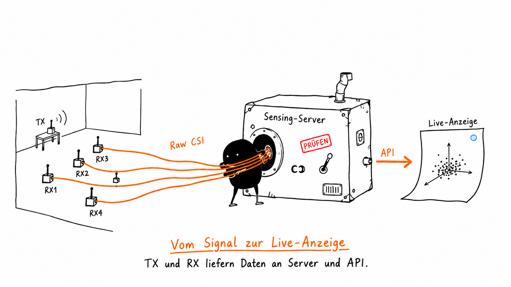

# Softwarearchitektur

Observatory baut auf einem angepassten RuView-Quellsnapshot auf. Der Sender erzeugt WLAN-Verkehr; RX1–RX4 erfassen CSI und übertragen Messdaten an den Host. Der Rust-Sensing-Server verarbeitet Daten, verwaltet Experimente und stellt Schnittstellen für die Browseroberfläche bereit. Radar läuft als separater Referenzpfad.



*Vereinfachter Datenweg: Der TX sendet WLAN-Pakete; die RX erfassen und übertragen CSI. Die Zeichnung ist kein Nachweis einer geprüften Live-Position.*

```text
TX → WLAN → RX1–RX4 → CSI-Transport → Sensing-Server → Browseroberfläche
                                      ↑
LD2450 → ESP32-C3 → Radartransport ───┘  getrennte Referenz
```

| Bereich | Aufgabe | Einstieg |
| --- | --- | --- |
| Firmware | Sender, CSI-Empfang und mmWave-Anbindung | [Firmwareübersicht](../setup/firmware.md) |
| Sensing-Server | Empfang, Verarbeitung, Experiment- und Positionspfade | [Server-README](../../software/ruview/v2/crates/wifi-densepose-sensing-server/README.md) |
| Browser | Status, Sensing und Experiment-Cockpit | [Benutzeranleitung](../user-guide/interface.md) |
| Referenz | Radardaten und Transformation ins Raumkoordinatensystem | [mmWave](mmwave.md) |

Simulation und Live-Eingang sind unterschiedliche Datenquellen. Ein erfolgreich verbundener Server beweist weder frische Hardwaredaten noch die Genauigkeit eines Positionsmodells. Für einen Experimentlauf müssen Aufbau, Profile und Datenkontext zusammenpassen.

Der vorhandene D6-Ansatz arbeitet mit diskreten Punkten beziehungsweise Zonen. Die angestrebte kontinuierliche WiFi-Ortung und ihr unabhängiger Test sind ein nachgelagertes Ziel, kein bereits nachgewiesener Funktionsumfang. Die Rolle von Radar und die Trennung zwischen Training und Blindtest beschreibt [Positionierung](positioning.md).

Quellen: [Software-Einstieg und Herkunft](../../software/README.md), [historische Architektur mit D6](../../experiment-reports/architecture/architecture.md) und [Projekt-README](../../README.md#wie-es-funktioniert). Die historische Architektur beschreibt den damaligen P01–P09-Ablauf; dieser ist kein verpflichtender Ablauf für die angestrebte Laufkalibrierung.
