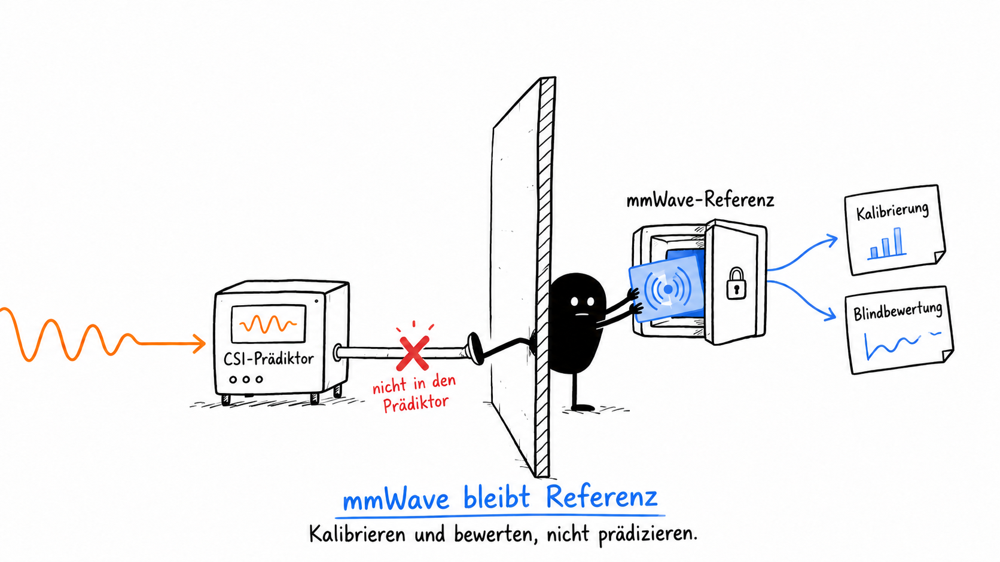

# mmWave als Referenz

Die HLK-LD2450-Radare werden über ESP32-C3-Knoten angebunden. Sie bilden einen von der WiFi-CSI-Schätzung getrennten Datenpfad. Vorgesehen sind zwei Sensoren für Kalibrierungslabels und den späteren Vergleich; die gemeinsame Raum- und Zeitabnahme ist noch offen.

## Vom Sensor in den Raum

Die Firmware überträgt Radarziel-Slots mit Knotenidentität und Zeitinformationen an den Server. Für den Sensing-Server sind die lokalen Rohkoordinaten und die zugehörige Node-ID maßgeblich; der Server wendet die im Setup hinterlegte Raumtransformation an. Die drei Sensor-Slots sind keine dauerhaften Personenidentitäten.

Für eine verwendbare Referenz müssen Sensorzuordnung, Montagepunkt, Blickrichtung, Links-/Rechts-Spiegelung und Zeitbezug überprüft werden. Die Firmwareanleitung empfiehlt, die Transformation an mehreren vermessenen Bodenmarkierungen zu prüfen. Eine plausible Vorschau ersetzt diese Prüfung nicht.

## Kalibrierung und Blindtest trennen

Radardaten können synchronisierte Trainingsbeispiele beschriften, sobald die Referenz selbst geprüft ist. Für einen Blindvergleich wird das WiFi-Modell vorher eingefroren; Radardaten dienen anschließend als getrennte Vergleichswahrheit. Eine im UI sichtbare Radarposition ist keine vom WiFi-Modell geschätzte Position.

*Die Darstellung erklärt die Trennung. Radar kann Trainingsdaten beschriften, dient aber nicht als Eingabe für die zu prüfende WiFi-Vorhersage.*

Der historische 60-Sekunden-Vergleich mit Firmware 0.1.6 enthielt keine verlorene Sequenz im untersuchten Fenster. Das belegt weder allgemeine Verlustfreiheit noch Radar-Positionsgenauigkeit oder die gemeinsame Abnahme beider Sensoren.

Quellen: [mmWave-Firmware und Messvertrag](../../software/ruview/firmware/esp32-mmwave-node/README.md), [Transportvergleich](../../experiment-reports/2026-09-20_mmwave-sequenzverlustvergleich/README.md), [Hardware](../hardware/overview.md) und [Positionierung](positioning.md).

## Historischer Transportvertrag

Die [historische Architektur](../../experiment-reports/architecture/architecture.md#aktuelle-mmwave-verbindung) dokumentiert ACKs für dieselbe `boot_id`/`sequence`, Retry mit unveränderter Messungsidentität, einen Starttimeout von 150 ms, adaptive RTT und eine Kappe bei 2000 ms. Der Abschnitt zeigt den ACK-Verbindungsfluss und ordnet ihn in den damaligen D6-Ablauf ein. Das ist ein datierter Implementierungsvertrag, keine neue Verlustfreiheits-, Zeit- oder Positionsabnahme.
