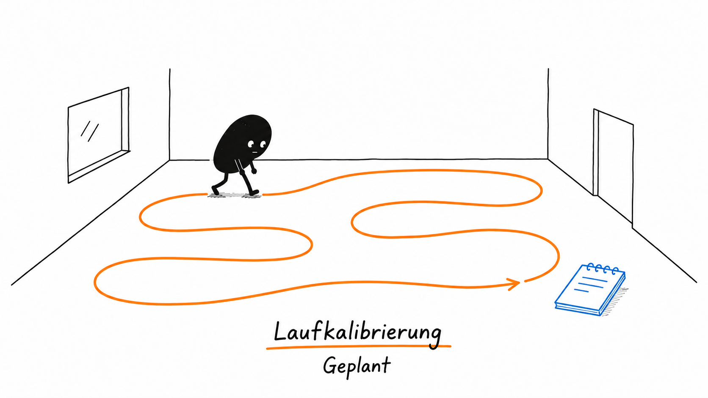
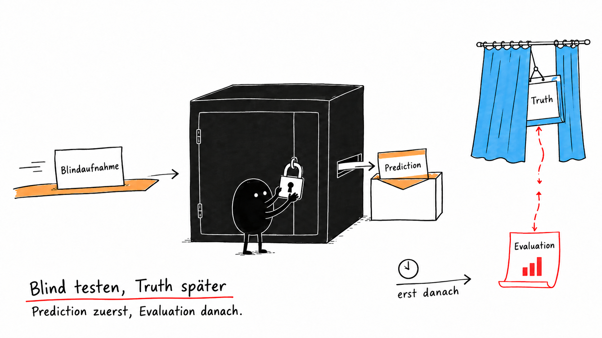

# Positionierung und Validierung

Das Ziel ist, eine Person während freier Bewegung aus WiFi-CSI auf der Bodenebene zu lokalisieren. Die angestrebte Kalibrierung soll durch langsames Ablaufen des Raums erfolgen. Zwei überprüfte mmWave-Sensoren sollen dafür Referenzdaten liefern. Eine zuverlässige kontinuierliche WiFi-Ortung ist als Gesamtfunktion noch nicht nachgewiesen.

*Geplanter Kalibrierungsablauf, keine Darstellung einer bereits validierten Positionsmessung.*

## Vorhandener Ansatz und Ziel

Der bisherige D6-Pfad verwendet Fingerprints für diskrete Punkte beziehungsweise Zonen. Bei unzureichender oder mehrdeutiger Evidenz muss er `unknown` oder `ambiguous` ausgeben. Eine Folge geglätteter diskreter Punkte ist für sich genommen noch kein Nachweis kontinuierlicher Ortung.

Das ältere P01–P09-Raster und seine Blindtestvorgaben sind historische beziehungsweise optionale Kontrollverfahren. Sie sind nicht mit dem Ziel einer Laufkalibrierung gleichzusetzen. Der [Live-Datenvertrag der Observatory-Ansicht](../../software/ruview/ui/observatory/LIVE_DATA_CONTRACT.md) beschreibt die strengeren Bedingungen für die dortige diskrete Positionsanzeige.

## Geplanter Messablauf

1. Raum, TX, RX und Radare aufeinander abgestimmt erfassen; Identität und Qualität der Datenquellen prüfen.
2. Eine passende Leerraumreferenz aufnehmen und deren Setupbindung festhalten.
3. Langsame Wege durch den nutzbaren Raum einschließlich Richtungswechseln erfassen. Für Labels nur zuvor geprüfte Radarpositionen mit geklärtem Raum- und Zeitbezug verwenden.
4. Trainings- und Validierungsaufnahmen als getrennte Sitzungen behandeln; überlappende Fenster derselben Sitzung nicht auf beide Gruppen verteilen.
5. Das WiFi-Modell einfrieren und auf unabhängigen Blinddaten prüfen. Prediction und Referenz erst für die Auswertung zusammenführen.
6. Abdeckung, Positionsfehler, Datenqualität, unbekannte Zustände und Grenzen ausweisen. Einen zweiten Aufbau gesondert prüfen.

*Die Referenz kann während der Aufnahme getrennt erfasst werden. Für den Blindvergleich wird sie erst nach der festgehaltenen WiFi-Vorhersage zur Bewertung herangezogen.*

Dies ist die fachliche Zielreihenfolge, keine Behauptung, dass alle Schritte bereits automatisch oder live abgenommen funktionieren. Der [Experiment-Cockpit-Guide](../../software/ruview/ui/observatory/EXPERIMENT_SETUP_GUIDE.md) dokumentiert vorhandene UI-Abläufe; ältere Raster- und Zeitangaben darin sind an den jeweiligen Versuch gebunden.

Quellen: [Projekt-README](../../README.md#was-observatory-kann), [historische D6-Architektur](../../experiment-reports/architecture/architecture.md) und [Ergebnisse](../research/results.md).
