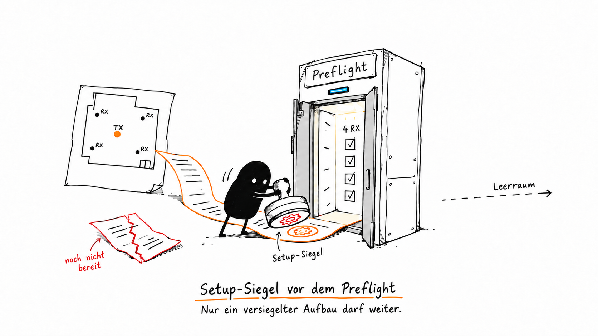
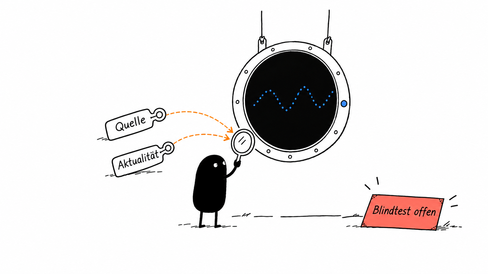

# Benutzeranleitung für die Oberfläche

Starte zum Kennenlernen den Server wie unter [Installation](../setup/installation.md) beschrieben und öffne die Sensing-Ansicht. In der Simulation sind Anzeigen und Aufnahmen künstlich; sie belegen keine angeschlossene Hardware oder reale Position.

## Ansichten

| Bereich | Zweck |
| --- | --- |
| Dashboard | Überblick über Server- und Systemzustände. |
| Hardware | Zeigt die vom Sensing-Server gemeldeten Nodes und verfügbare Steuerungsbereiche. |
| Live Demo | Stellt Demo- und Live-Funktionen dar; Datenquelle und Kennzeichnung beachten. |
| Sensing | Zeigt Sensing-Daten und den Einstieg in den Experimentablauf. |
| Training | Oberfläche für Trainingsfunktionen; ein UI-Element allein belegt keinen validierten Modelllauf. |
| Observatory | Separate Visualisierung über den Eintrag im weiteren Menü. |

## Ein Experiment vorbereiten

*Schematischer Ablauf für einen echten Positionsversuch; die dargestellten Gerätepositionen sind keine Aufbauvorgabe. Die Simulation braucht kein Hardware-Siegel.*

1. Im Experiment-Cockpit ein Setup-Profil öffnen. Raummaße sowie TX- und RX-Positionen im gemeinsamen Koordinatensystem prüfen und eine Profilversion speichern.
2. Einen Experiment-Run mit Namen und gespeichertem Profil anlegen.
3. Für einen realen Versuch das zum Server und zur Hardware passende versiegelte Setup und die geforderten Identitäten bereitstellen. Ein gespeichertes Profil allein ersetzt das Laufzeitsiegel und die Hardwareprüfungen nicht.
4. Eine geeignete Leerraumreferenz und die getrennte mmWave-Kalibrierung vorbereiten. Bei fehlendem Sensor oder fehlenden RX-Daten bleibt der betreffende Schritt offen.
5. Aufnahmen und Blindprüfung erst mit geeignetem Aufbau durchführen. WiFi-Vorhersage und Referenz für die spätere Auswertung getrennt halten.

Die [bebilderte Cockpit-Anleitung](../../software/experiment-cockpit.md) und der [ausführliche Experimentleitfaden](../../software/ruview/ui/observatory/EXPERIMENT_SETUP_GUIDE.md) beschreiben einzelne Bedienelemente. Ältere Abläufe und Raster darin gelten nicht automatisch als aktuelle Abnahmekriterien.

## Anzeigen richtig lesen

Die separate Observatory-Ansicht unterscheidet unter anderem `CONNECTING`, `LIVE ESP32`, `SIMULATED` und `STALE`. Ein sichtbares Signalfeld ist eine Diagnoseansicht, keine gemessene Person. Ein Positionsmarker erscheint nur unter den im [Live-Datenvertrag](../../software/ruview/ui/observatory/LIVE_DATA_CONTRACT.md) genannten Quellen-, Geometrie- und Positionsbedingungen; er ist keine Körperpose.

*Quellen- und Aktualitätsprüfungen betreffen die Anzeige. Ein unabhängiger Blindtest bewertet die Positionsqualität gesondert; er ist kein hier dargestelltes automatisches Anzeigegate.*

Bei fehlender Verbindung Server und gewählte Datenquelle prüfen. Fehlende, veraltete oder simulierte Daten nicht als reale Messung ausgeben. Die in der Oberfläche angezeigten Fehlermeldungen und die tatsächliche Datenquelle sind für die Diagnose wichtiger als eine optisch aktive Animation.

Quellen: [UI-Navigation](https://github.com/Gerafftes/Observatory/blob/028f9d3f2703e1f3610e856f48fa0a709647818b/software/ruview/ui/index.html), [Cockpit-Anleitung](../../software/experiment-cockpit.md) und Live-Datenvertrag. Diese Anleitung wurde anhand von Quellen erstellt, nicht durch einen neuen Browser- oder Hardwaretest.
