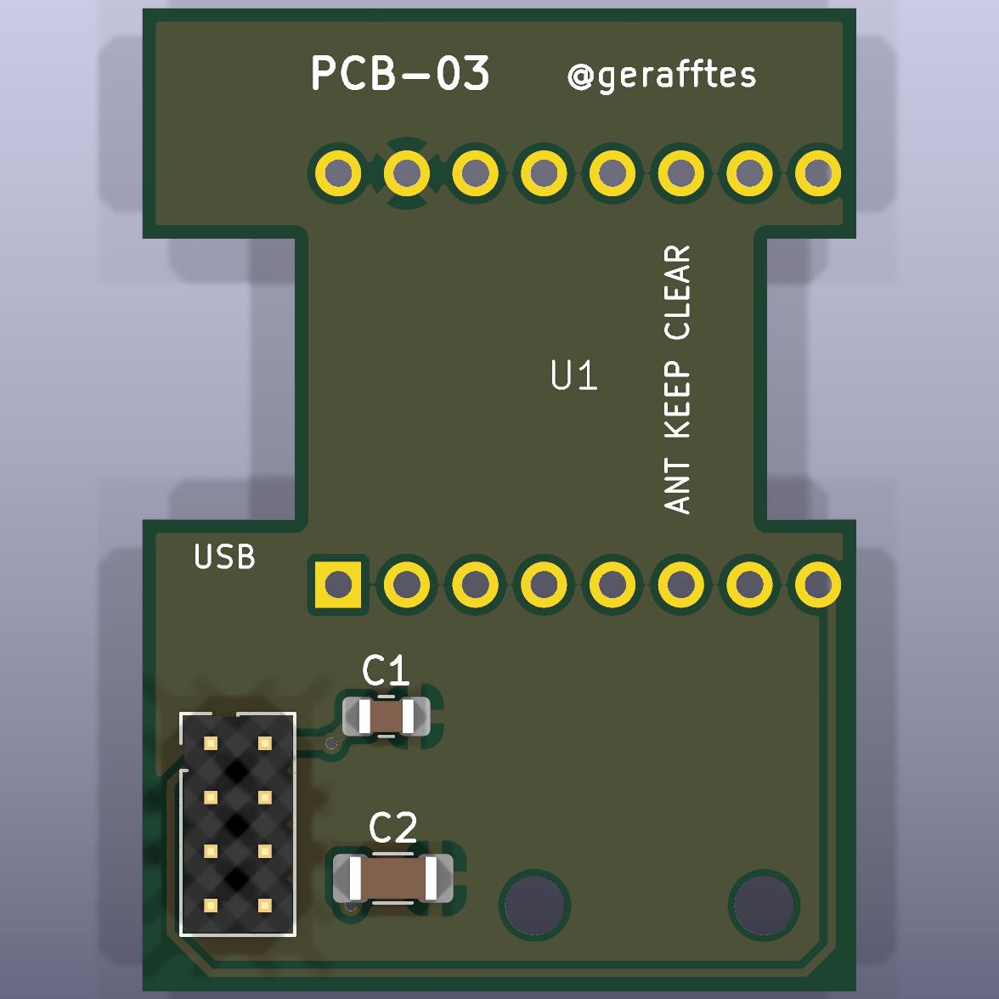
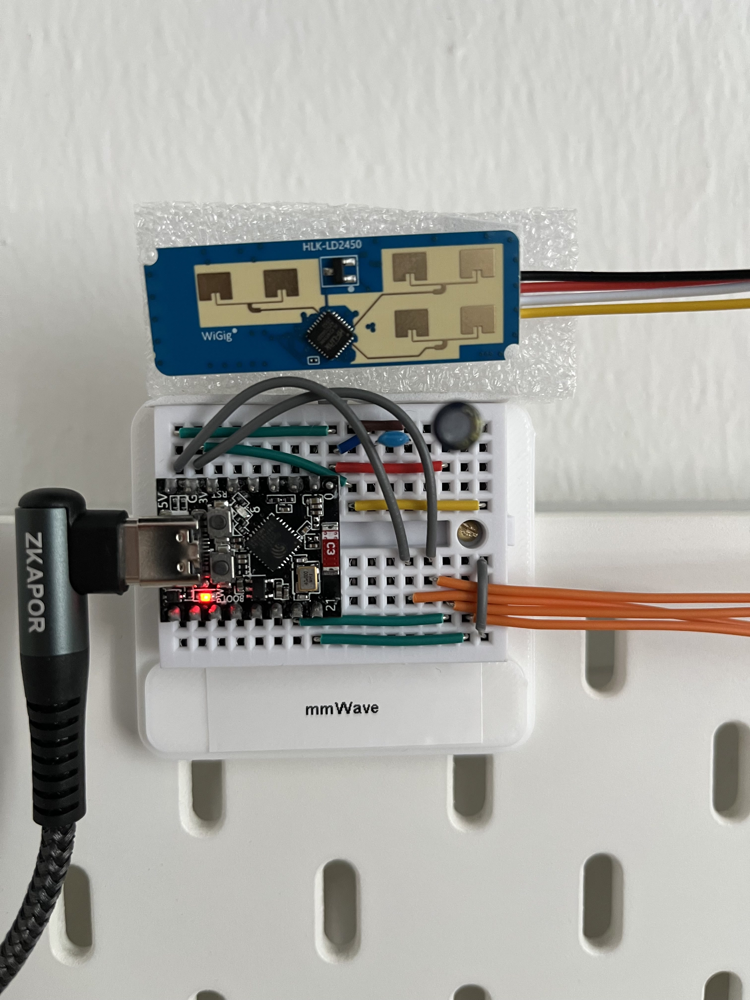

# Hardware

[Deutsch](README.md)

The WiFi CSI setup consists of five ESP32-S3 boards. Two separate ESP32-C3
nodes, each with an HLK-LD2450, are intended for the independent mmWave
reference; their joint acceptance remains open. The [hardware overview](../docs/hardware/overview.md)
describes the complete setup (German).

## Board revisions

**PCB-03 is the intended current revision.** PCB-01 and PCB-02 remain historical
predecessors. PCB-03 corrects the LD2450 orientation by 180° relative to PCB-02,
keeps the SMD capacitors, and preserves the outer dimensions and mounting holes
of the earlier revisions.

The [PCB-03 page](pcb-03/README.md) records geometry and UART mapping.
KiCad projects, POC schematics, Gerber/drill data, and ordering archives belong
to a separate hardware source package; they are not included in this
documentation snapshot. The preview establishes no DRC, manufacturing, fit,
or device acceptance result.

## Breadboard variant

The photo documents the provisional breadboard variant. The
[breadboard page](breadboard/README.en.md) lists fastening hardware, capacitors,
and open checks for printing, insertion temperature, and fit. It is not an
assembly guide with an accepted result.

## ESP32-S3 enclosure

The external MakerWorld model
[*ESP32 S3 Wroom Case*](https://makerworld.com/de/models/1456361-esp32-s3-wroom-case#profileId-1517915)
by [`aiekick`](https://makerworld.com/de/@aiekick) is the intended enclosure.
The documented source revision lists the **MakerWorld Standard Digital File
License**. The STL is not redistributed here; check the current license at the
source. This does not establish enclosure fit or device acceptance.
