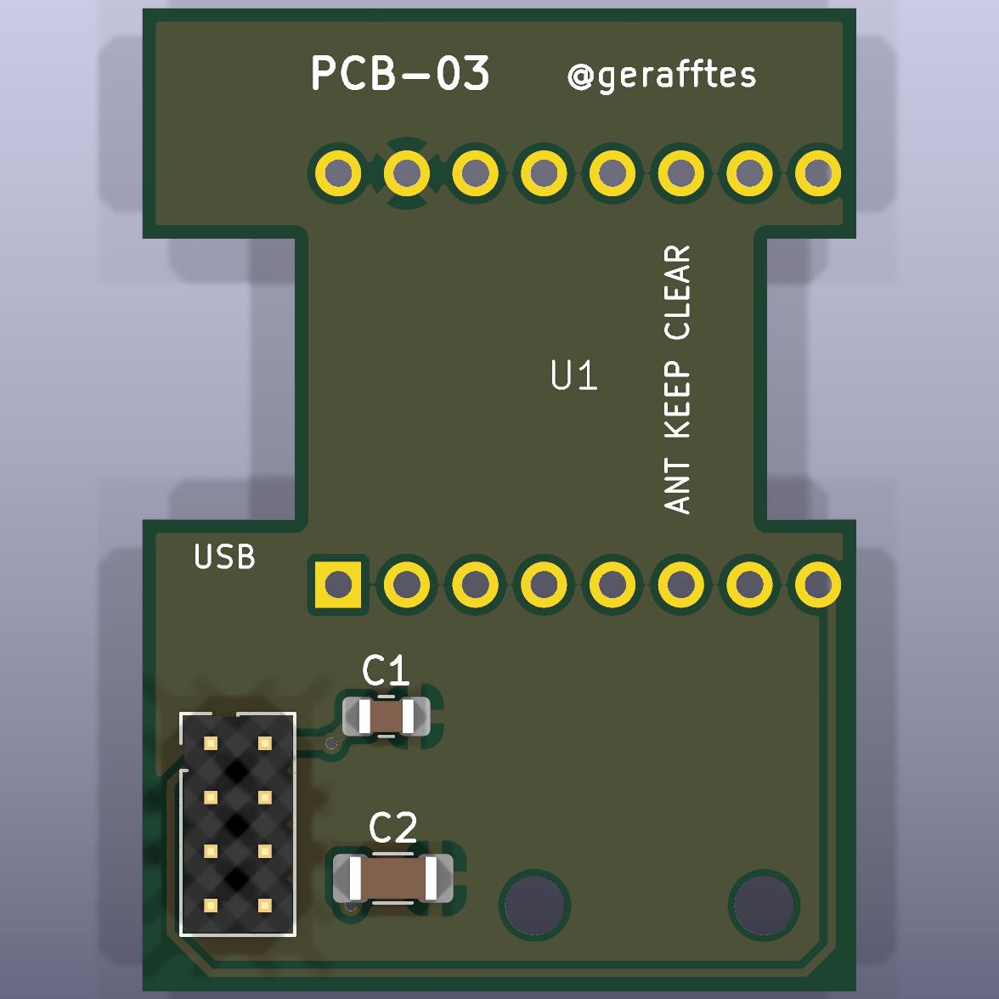
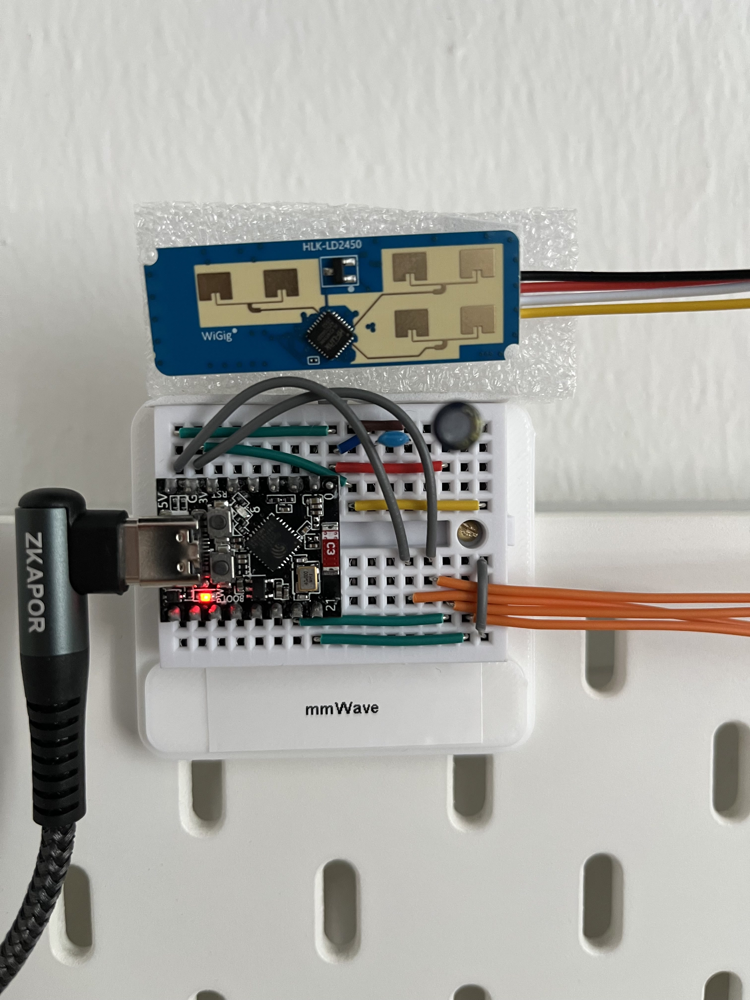

# Hardware

[English](README.en.md)

Der WLAN-CSI-Aufbau besteht aus fünf ESP32-S3-Boards. Für die getrennte
mmWave-Referenz sind zwei ESP32-C3-Knoten mit jeweils einem HLK-LD2450 vorgesehen;
ihre gemeinsame Abnahme ist noch offen. Die [Hardwareübersicht](../docs/hardware/overview.md)
ordnet den Gesamtaufbau ein.

## Platinenrevisionen

**PCB-03 ist die vorgesehene aktuelle Revision.** PCB-01 und PCB-02 bleiben
historische Vorstufen. PCB-03 übernimmt die gegenüber PCB-02 korrigierte
180°-Ausrichtung des LD2450, verwendet weiterhin SMD-Kondensatoren und behält
die Außenmaße sowie Montagebohrungen der früheren Revisionen bei.

Die [PCB-03-Seite](pcb-03/README.md) hält Geometrie und UART-Zuordnung fest.
KiCad-Projekte, POC-Schaltpläne, Gerber-/Bohrdaten und Bestellarchive gehören
in ein separates Hardware-Quellpaket; sie sind in diesem Dokumentationsstand
nicht enthalten. Die Vorschau belegt weder DRC noch Fertigungs-, Pass- oder
Geräteabnahme.

## Breadboard-Variante

Das Foto dokumentiert die provisorische Breadboard-Variante. Die
[Breadboard-Seite](breadboard/README.md) nennt Befestigungsteile, Kondensatoren
und offene Prüfungen zu Druck, Einpress-Temperatur und Passprobe. Sie ist keine
Bauanleitung mit abgenommenem Ergebnis.

## ESP32-S3-Gehäuse

Als Gehäuse ist das externe MakerWorld-Modell
[*ESP32 S3 Wroom Case*](https://makerworld.com/de/models/1456361-esp32-s3-wroom-case#profileId-1517915)
von [`aiekick`](https://makerworld.com/de/@aiekick) vorgesehen. Der dokumentierte
Quellstand nennt die **MakerWorld Standard Digital File License**. Die STL wird
hier nicht weiterverteilt; die aktuelle Lizenz ist an der Quelle zu prüfen.
Eine Gehäuse-Passprobe oder Geräteabnahme wird daraus nicht abgeleitet.
