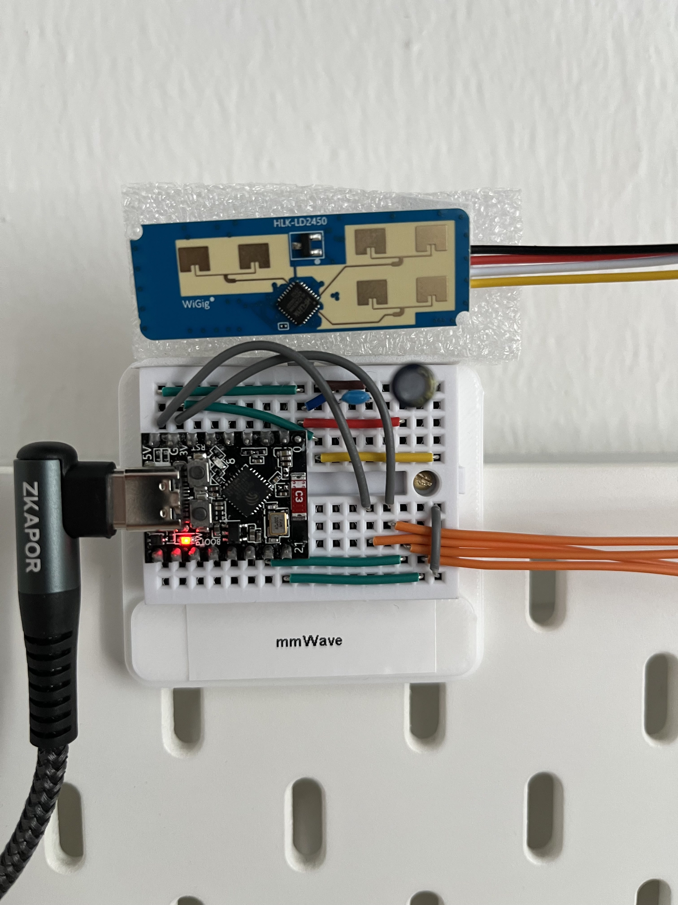
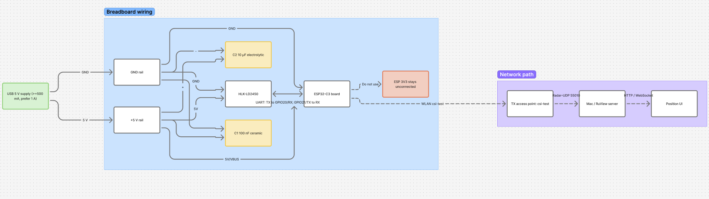

# Breadboard setup

[Deutsch](README.md)

This page documents the provisional HLK-LD2450 and ESP32-C3 breadboard
variant, its fastening hardware, and additional capacitors. The full setup
intends two separate ESP32-C3/LD2450 reference nodes; their joint acceptance
remains open. [Hardware overview](../README.en.md).

## Setup and CAD scope

The breadboard body CAD file belongs to a separate hardware source package
and is not included in this documentation snapshot. The photo does not replace
wiring, printing, or device checks.

The photo documents the provisional setup with the HLK-LD2450 and ESP32-C3.
Print orientation, material, and fit have not yet been validated.

## Wiring and data path

The HLK-LD2450 sends data to the ESP32-C3 over UART. The ESP32-C3
forwards radar data over Wi-Fi to UDP port `55010` on the sensing server.
The browser connects to the server over HTTP and WebSocket.

## Fastening hardware used

| Part | Specification | Link |
|---|---|---|
| Heat-set insert | M1.6 × 2.5 | [CNCKitchen: Heat Set Insert M1.6 × 2.5](https://cnckitchen.store/products/heat-set-insert-m1-6-100-pieces-kopie) |
| Installation tip | M1.6 × 1 | [CNCKitchen: Installation Tips (collection; the exact M1.6 × 1 tip is not archived separately)](https://cnckitchen.store/collections/soldering-tips-and-sets) |
| QUARKZMAN wood screws | M1.6 × 8 mm, slotted round head, brass, self-tapping, 40 pieces | — |

The documented `40 pieces` is the quantity procured for this setup. Seller
listings and pack sizes can change. The links are sourcing/comparison links,
not availability guarantees. Insertion temperature and fit have not yet been
validated.

## Breadboard mmWave components

| Part | Specification | Quantity | Documented price | Link |
|---|---|---:|---:|---|
| X7R-2.5 100N MUR | 100 nF multilayer ceramic capacitor, 50 V, X7R, 10%, 2.5 mm pitch, ammo | 1 | €0.10 | [Reichelt: X7R-2.5 100N MUR](https://www.reichelt.de/de/de/shop/produkt/vielschicht-kerko_100_nf_50_v_x7r_10_rm_2_5_ammo-22853) |
| FC-A 10U 50 | Radial electrolytic capacitor, 10 µF, 50 V, 2.5 mm pitch, 105 °C, 1000 h, 20% | 1 | €0.15 | [Reichelt: FC-A 10U 50](https://www.reichelt.com/fr/fr/shop/produit/condensateur_electrolytique_radial_10_f_50_v_rm_2_5_105_c_-228384) |

Prices are the project values documented at the time of procurement and are not
current price guarantees.
