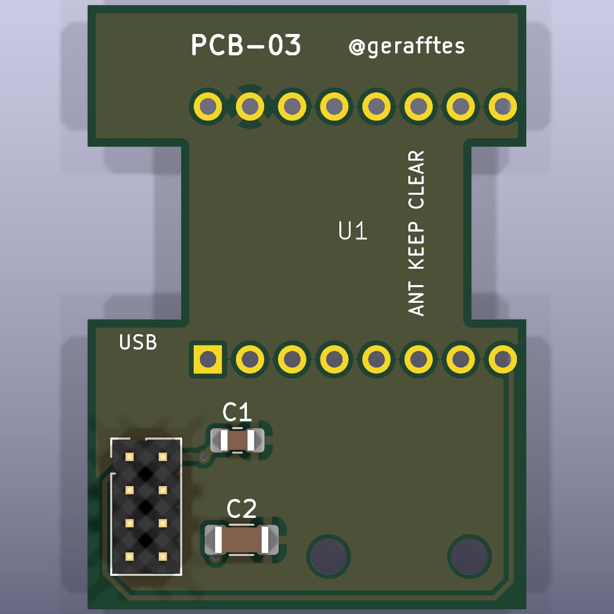

# PCB-03 – ESP32-C3 / LD2450 carrier

[Hardware overview](../README.en.md) · [Hardwareübersicht](../README.md)

PCB-03 is the intended current layout revision based on PCB-02. PCB-01 and
PCB-02 remain historical predecessors. The documented change rotates the
LD2450 connector and its UART mapping by 180° to align the sensor with the
intended board orientation:

- ESP GPIO21/TX → LD2450 RX.
- ESP GPIO20/RX ← LD2450 TX.
- C1 (100 nF) and C2 (10 µF) remain SMD parts.
- F.Cu and B.Cu contain GND planes; the antenna keep-out is marked `ANT KEEP CLEAR`.
- The documented outline is 26.45 × 36.42 mm, with mounting holes at
  (163.50, 89.00) mm and (172.00, 89.00) mm, retained from PCB-01/PCB-02.

## Source package and open acceptance

This page records the design intent and existing preview. KiCad sources,
Gerber/Excellon files, ordering archives, and their validation records belong
to a separate hardware source package and are not included in this
documentation snapshot. No DRC or manufacturing readiness is established here.

The documented dimensions do not establish physical enclosure fit. A
manufactured and assembled PCB still requires electrical and mechanical
checks. The overall reference setup intends two ESP32-C3 nodes, each with an
HLK-LD2450; their joint device acceptance remains open.
