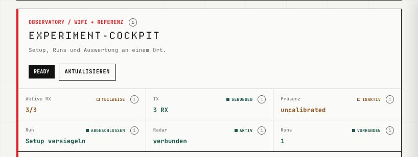
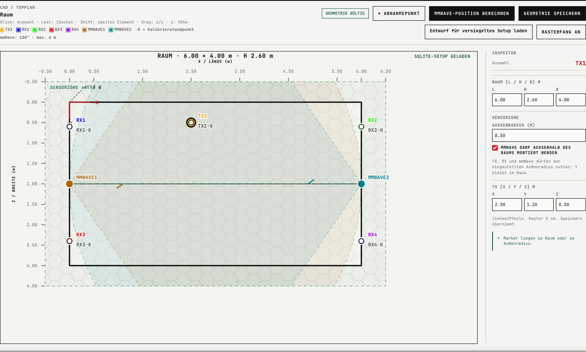
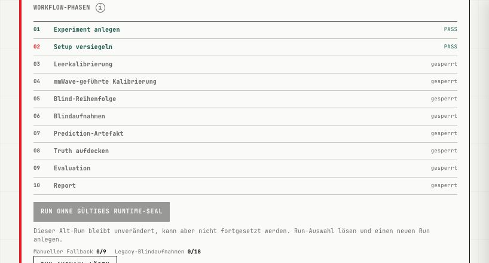

# Experiment cockpit and mmWave calibration

[Deutsch](experiment-cockpit.md)

The live and workflow views were captured on 7 November 2026. The CAD view uses a separate demo profile.

## Room setup

The demo room is 6 × 4 m with a ceiling height of 2.60 m. During an experiment, the run can retain its sealed geometry.

## Workflow phases

The visible older run has no valid runtime seal and is blocked from continuing.

## Workflow and limits

1. Save room dimensions, TX/RX positions and an immutable profile revision.
2. Bind an experiment run to that revision. A saved profile alone is not an active runtime seal.
3. A real measurement needs the complete setup binding, appropriate identities and live gates. A demo cannot substitute for that evidence.
4. Prepare an empty WiFi baseline and separate mmWave calibration. Missing RX means no valid fingerprints; missing radar means the reference remains waiting.
5. Keep blind captures separate from the reference. Register and hash-bind prediction first, then reveal truth.
6. Evaluate accuracy, coverage, distance error, unknown/ambiguous states and quality gates. Without real data the report remains `SOFTWARE-ONLY / UNVALIDATED`.

The recorded mmWave assistant covers connection, alignment, coverage, zones, training, blind testing and results. The former HTTP-502/offline image remains a historical error-state record in the software documentation.

The [interface guide](../docs/user-guide/interface.md) separates simulation, display and measurement evidence. The [historical experiment guide](ruview/ui/observatory/EXPERIMENT_SETUP_GUIDE.md) describes setup/run binding; the [live data contract](ruview/ui/observatory/LIVE_DATA_CONTRACT.md) constrains discrete display. These contracts do not establish continuous WiFi positioning or joint acceptance of two radars. The linked detailed guides are in German except for the live data contract.
