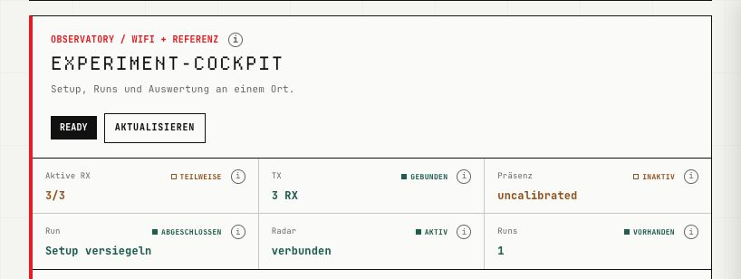
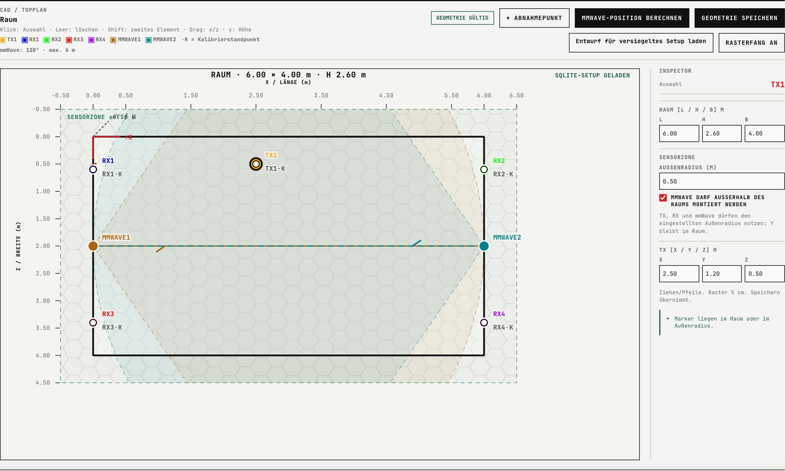
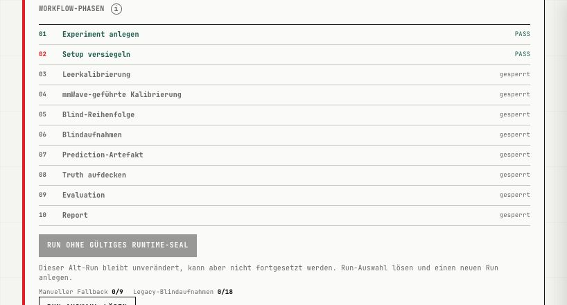

# Experiment-Cockpit und mmWave-Kalibrierung

[English](experiment-cockpit.en.md)

Die Live- und Workflow-Ansichten stammen vom 7. November 2026. Die CAD-Ansicht zeigt ein separates Demo-Profil.

## Raum-Setup

Der Demo-Raum ist 6 × 4 m groß und 2,60 m hoch. Bei einem Versuch kann weiterhin die versiegelte Geometrie des Runs gelten.

## Workflow-Phasen

Der sichtbare ältere Run besitzt kein gültiges Runtime-Seal und ist für die Fortsetzung gesperrt.

## Ablauf und Grenzen

1. Raummaße, TX-/RX-Positionen und eine unveränderliche Profilversion speichern.
2. Einen Experiment-Run an genau diese Profilversion binden. Das Speichern eines Profils ist noch kein aktives Laufzeitsiegel.
3. Für eine reale Messung die vollständige Setupbindung mit passenden Identitäten und Live-Gates herstellen; eine Demo kann diesen Schritt nicht als Hardwarebeweis ersetzen.
4. Leere WiFi-Baseline und getrennte mmWave-Kalibrierung vorbereiten. Ohne RX fehlen gültige Fingerprints, ohne Sensor wartet der Radarstatus.
5. Blindaufnahmen von der Referenz getrennt erfassen. Prediction zuerst registrieren und hashbinden, Truth erst danach aufdecken.
6. Accuracy, Coverage, Fehlerdistanz, unbekannte/mehrdeutige Zustände und Qualitätsgates auswerten. Ohne echte Daten bleibt der Report `SOFTWARE-ONLY / UNVALIDATED`.

Der dokumentierte mmWave-Assistent führt durch Verbindung, Ausrichtung, Abdeckung, Zonen, Training, Blindtest und Ergebnis. Die frühere HTTP-502-/Offline-Aufnahme bleibt als historischer Fehlerzustand in der Softwaredokumentation erhalten.

Die [Benutzeranleitung](../docs/user-guide/interface.md) trennt Simulation, Anzeige und Messnachweis. Der [historische Experimentleitfaden](ruview/ui/observatory/EXPERIMENT_SETUP_GUIDE.md) erklärt die Setup-/Run-Bindung; der [Live-Datenvertrag](ruview/ui/observatory/LIVE_DATA_CONTRACT.md) begrenzt die diskrete Anzeige. Ein vorhandener Bedienablauf ist kein Nachweis kontinuierlicher WiFi-Ortung oder zweier gemeinsam abgenommener Radare.
